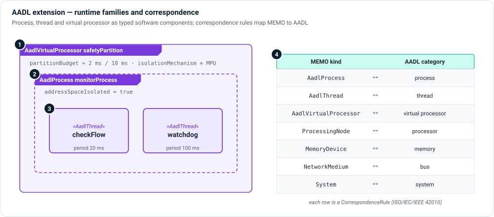

# AADL extension

`memo_extension_aadl` adds the runtime component families of AADL
(SAE AS5506)—process, thread and virtual processor—and a **correspondence
profile** that states what each MEMO kind means in AADL terms. Use it when a
safety argument rests on partitioning and scheduling, or when the architecture
is exchanged with AADL tools.

```sysml
public import memo_extension_aadl::*;
```



1. **Virtual processor** — `AadlVirtualProcessor` is a partition scheduled with
   a guaranteed `partitionBudget` and an `isolationMechanism` (MMU, MPU,
   hypervisor, ARINC 653 OS). A budget nothing enforces is a plan, not a control;
   the attribute makes the enforcement explicit.
2. **Process** — `AadlProcess` is a protected address space. Set
   `addressSpaceIsolated`; a process without it is a scheduling unit, not a
   containment boundary, and no partitioning claim may rest on it.
3. **Thread** — `AadlThread` is a schedulable unit inside one process. The base
   timing properties (period, deadline, WCET, priority) are AADL thread
   properties already; the extension adds the owning process.
4. **Correspondence** — each `CorrespondenceRule` maps a MEMO kind to an AADL
   category (ISO/IEC/IEEE 42010 correspondence). It records what MEMO already
   means; it does not claim MEMO *is* AADL.

| MEMO kind | AADL category |
|---|---|
| `AadlProcess` | process |
| `AadlThread` | thread |
| `AadlVirtualProcessor` | virtual processor |
| `ProcessingNode` | processor |
| `MemoryDevice` | memory |
| `NetworkMedium` | bus |
| `System` (logical) | system |

AADL concepts with no MEMO counterpart (subprogram, device, abstract) and MEMO
concepts with no AADL counterpart (the assurance layers) are deliberately not
mapped.

## Example

```sysml
part safetyPartition : AadlVirtualProcessor {
    attribute :>> partitionBudget = 2 [milli*s];
    attribute :>> isolationMechanism = "MPU-enforced memory regions, time-partitioned scheduler";
}
part monitorProcess : AadlProcess {
    attribute :>> addressSpaceIsolated = true;
}
part checkFlow : AadlThread {
    attribute :>> owningProcessName = "monitorProcess";
    attribute :>> periodMs = 20 [milli*s];
}
```

## Views

Draw partitions, processes and threads as nested parts in an
[interconnection view](../views/interconnection.md); the nesting itself is the
containment argument. Use `IndependentOf` in the
[logical layer](../layers/logical.md) for the independence claim the partitions
implement.
