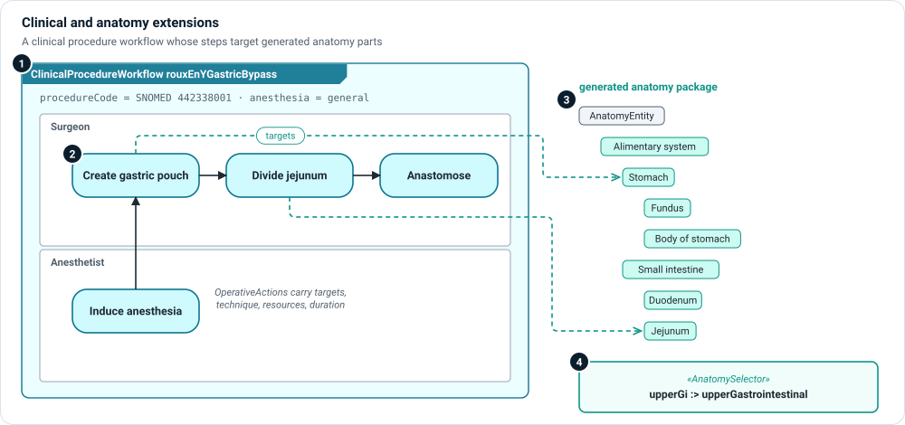

# Clinical and anatomy extensions

For devices used in a procedure—surgical instruments, robots, implants—the
operational layer has to describe the procedure itself: what is done, by whom,
and to which part of the body. Two extensions add that vocabulary.

```sysml
public import memo_extension_clinical::*;   // also brings in anatomy
```



1. **Clinical procedure workflow** — `ClinicalProcedureWorkflow` specializes the
   base `ClinicalWorkflow` and adds `procedureCode` (a terminology code such as
   SNOMED CT), `clinicalObjective` and `anesthesiaRequirement`. Its scenarios hold
   the steps, as for any workflow.
2. **Steps** — the steps are ordinary `OperativeAction`s with performers,
   techniques, resources and durations. Duration is set on the steps, per
   variant, and rolled up—not entered as one number on the workflow.
3. **Generated anatomy** — a step's `targets` reference anatomy **parts**, not
   coded strings. The anatomy extension holds no anatomy itself: your project
   generates a package of part definitions from the Foundational Model of
   Anatomy (FMA), with each part's FMA code and its place in the hierarchy.
4. **Anatomy selectors** — an `AnatomySelector` names FMA seed classes and a
   depth. The extension ships presets such as `upperGastrointestinal`
   (esophagus, stomach, duodenum, jejunum). Use one by subsetting it.

## Generate the anatomy

Declare what you need, then generate:

```sysml
part upperGi :> upperGastrointestinal;   // a shipped preset
part liver : AnatomySelector {
    attribute :>> fmaSeeds = ("fma7197");
    attribute :>> partDepth = 2;
}
```

```bash
memo-architect anatomy generate
```

The command writes the project's anatomy package from the union of its
selectors. In Architect, the element type picker shows anatomy as a hierarchy
(anatomy, then organ, then part).

!!! note "Attribution"
    The anatomy is derived from the Foundational Model of Anatomy (FMA) 5.1.0 by
    the Structural Informatics Group, University of Washington, under CC BY 4.0.
    Generated packages carry the same attribution.

## Kinds

| Kind | Extension | Use it for |
|---|---|---|
| `ClinicalProcedureWorkflow` | clinical | A procedure: code, objective, anesthesia. |
| `AnatomyEntity` | anatomy | The root of generated anatomy parts. |
| `AnatomySelector` | anatomy | Which FMA classes to generate, and how deep. |

## Views

- An operational flow ([action flow view](../views/action-flow.md)) with a
  swimlane per role shows the procedure.
- **☰ › Views › Use Cases** groups procedures under the use cases they realize,
  with variants as switchable rows.

The `gastric-bypass-variants` example in the ontology package models a Roux-en-Y
gastric bypass with variants, using both extensions.
