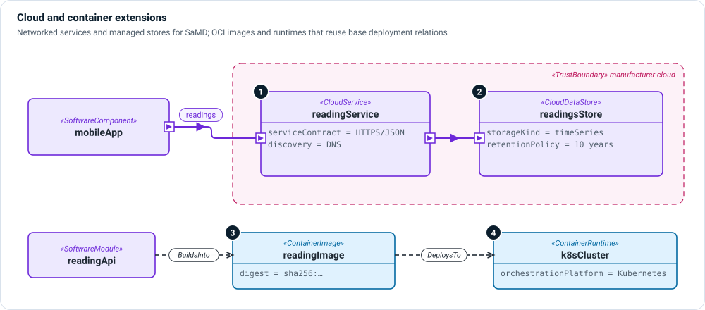

# Container and cloud extensions

Two small extensions cover software that runs on infrastructure the
manufacturer does not fully control—the usual case for software as a medical
device (SaMD) and for connected devices with a cloud back end.

```sysml
public import memo_extension_container::*;
public import memo_extension_cloud::*;
```



1. **Cloud services** — `CloudService` is a `SoftwareComponent` with
   `runtimeKind = service`. Record its `serviceContract` (protocol, endpoint,
   request and response—the boundary a verification case exercises) and its
   `discoveryMechanism`.
2. **Cloud data stores** — `CloudDataStore` is a `SoftwareComponent` with
   `runtimeKind = dataStore`, a `storageKind` (relational, document, key–value,
   object store, time series, block volume) and a `retentionPolicy`. Retention is
   a regulated obligation; the store is where it is met or not.
3. **Container images** — `ContainerImage` is a `SoftwareDeploymentUnit` with
   `imageReference`, `registry`, `baseImage` and, most importantly, `digest`: a
   tag can be re-pointed, a digest is what reproducibility can be argued from.
4. **Container runtimes** — `ContainerRuntime` is a `RuntimeEnvironment` with an
   `orchestrationPlatform` (Kubernetes, Nomad, Compose, none) and a
   `runtimeEngine` (containerd, CRI-O, Docker).

Because these kinds specialize base kinds, the base deployment relations work
unchanged: modules `BuildsInto` an image, the image `DeploysTo` a processing
node, and the node `ProvidesEnvironment` a container runtime. See
[Deployment and realization](../layers/deployment.md).

## Kinds

| Kind | Extension | Specializes |
|---|---|---|
| `CloudService` | cloud | `SoftwareComponent` |
| `CloudDataStore`, `CloudStorageKind` | cloud | `SoftwareComponent`, enum |
| `ContainerImage` | container | `SoftwareDeploymentUnit` |
| `ContainerRuntime` | container | `RuntimeEnvironment` |

## Example

```sysml
part readingsStore : CloudDataStore {
    attribute :>> storageKind = CloudStorageKind::timeSeries;
    attribute :>> retentionPolicy = "10 years after last device use, then deleted";
}

part readingImage : ContainerImage {
    attribute :>> imageReference = "registry.example.com/reading-api:1.4.0";
    attribute :>> digest = "sha256:9f2c1ad4e0b7";
}
allocation : BuildsInto allocate readingApi to readingImage;
allocation : DeploysTo allocate readingImage to cloudNode {
    attribute :>> deploymentKind = DeploymentKind::containerized;
}
```

Model the cloud boundary as a `TrustBoundary` in the
[cybersecurity layer](../layers/cybersecurity.md), so every exchange that
crosses it is reviewed as an attack surface.
