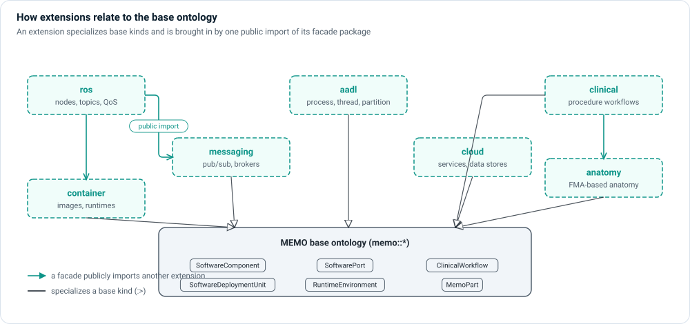

# Extensions

The base MEMO ontology is deliberately technology-neutral: a `SoftwareComponent`
can be a task, a process or a service, and a `ClinicalWorkflow` can describe any
procedure. When a project needs the vocabulary of a specific technology or
domain—ROS 2 nodes and topics, AADL threads, cloud data stores, surgical
procedures, human anatomy—it imports an **extension**.



## What an extension is

An extension is a plain SysML package that **specializes base kinds**. It adds
no new metaclass and no parallel relationship set:

- Its definitions specialize base definitions (`RosNode :> SoftwareComponent`,
  `ContainerImage :> SoftwareDeploymentUnit`), so every rule, view and
  relationship that applies to the base kind applies to them.
- Its definition names start with the extension's prefix (`Ros…`, `Aadl…`,
  `Cloud…`), so two extensions can never collide.
- It is used through one **facade** package, `memo_extension_<name>`, that
  publicly imports everything the extension ships and every extension it builds
  on. ROS, for example, brings in messaging and container.
- Relationships come from native SysML first—ports, interfaces, flows,
  allocations. An extension that does need a new relationship specializes a base
  MEMO relationship.

## The extensions that ship

| Extension | Adds | Builds on | Page |
|---|---|---|---|
| `ros` | ROS 2 nodes, messages, topic / service / action interfaces, QoS, container deployment | messaging, container | [ROS 2](ros.md) |
| `messaging` | Technology-neutral publish/subscribe: messages, publisher and subscriber ports, brokers | — | [Messaging](messaging.md) |
| `container` | OCI container images and container runtimes | — | [Container and cloud](cloud-container.md) |
| `cloud` | Networked services and managed data stores | — | [Container and cloud](cloud-container.md) |
| `aadl` | AADL process, thread and virtual processor, plus a MEMO ↔ AADL correspondence | — | [AADL](aadl.md) |
| `clinical` | Clinical procedure workflows with procedure codes and objectives | anatomy | [Clinical and anatomy](clinical-anatomy.md) |
| `anatomy` | Human anatomy from the Foundational Model of Anatomy, generated into your project | — | [Clinical and anatomy](clinical-anatomy.md) |
| `template` | The skeleton to copy when writing your own | — | [Write your own](authoring.md) |

## Use an extension in a project

Add one public import of the facade to the package that declares your project's
method binding (by default `model/methodology/project.sysml`):

```sysml
package memo_examples_ros_mobile_robot_project {
    public import memo_extension_ros::*;

    part projectBinding : ModelMethodBinding {
        ref :>> selectedMethodology = mdDefaultDefinition;
    }
}
```

That single line both makes the extension's definitions visible and **selects**
its packages for the model, because a public import passes its members on. A
private import only makes names visible and selects nothing.

Then use the extension's kinds in your catalog files exactly as you use base
kinds:

```sysml
part nodeLidar : RosNode {
    attribute :>> nodeNamespace = "/robot/perception";
    out port scanPublisher : RosPublisher { ref :>> topic = topicScan; }
}
```

In Architect, **Settings › Model › Methodology** shows the extensions the model
uses. Changing which extensions a project imports changes the vocabulary, so
Architect asks you to restart it rather than reloading in place.

!!! tip "See an extension in a complete model"
    The bundled `ros-mobile-robot` example uses the ROS 2 extension (and,
    through it, messaging and container). Open it with
    `memo-architect --example ros-mobile-robot`. The ontology
    package also contains `examples/gastric-bypass-variants` (clinical and
    anatomy) and `examples/software-only-medical-device` (cloud) to read.
