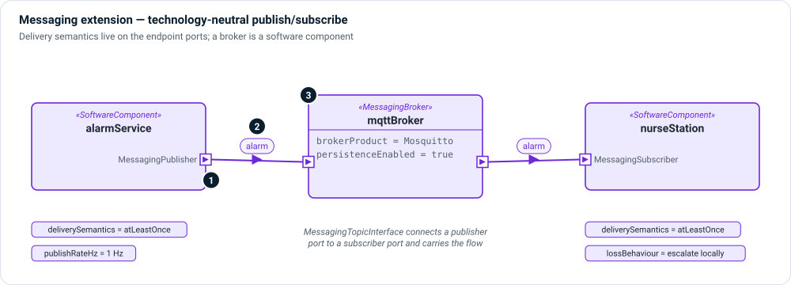

# Messaging extension

`memo_extension_messaging` models publish/subscribe communication without
committing to a product: DDS, MQTT, AMQP and Kafka all fit. It moves topic and
delivery properties off components, where they do not belong, and onto the
ports and interfaces that carry the messages.

```sysml
public import memo_extension_messaging::*;
```



1. **Publisher and subscriber ports** — `MessagingPublisher` (an `out` payload)
   and `MessagingSubscriber` (an `in` payload) specialize `SoftwarePort`. Each
   names its `topic` and states `deliverySemantics`: at most once, at least once
   or exactly once. A publisher also states its rate; a subscriber states what it
   does when messages are lost.
2. **Messages** — `MessagingMessage` is a `DataItem` with a schema. A named topic
   is an item usage of a message definition.
3. **Brokers** — `MessagingBroker` is a `SoftwareComponent` with
   `runtimeKind = messageBroker`, a product and a persistence setting.

A `MessagingTopicInterface` connects one publisher port to one subscriber port
and carries the message flow between their payloads.

!!! warning "Delivery semantics are a safety property"
    An alarm published at most once can be silently dropped; a command
    delivered at least once can be applied twice. Model the semantics on both
    ends and review them with the hazards they could cause.

## Kinds

| Kind | Specializes | Use it for |
|---|---|---|
| `MessagingMessage` | `DataItem` | A message type; topics are its usages. |
| `MessagingPublisher`, `MessagingSubscriber` | `SoftwarePort` | Endpoints with delivery semantics. |
| `MessagingTopicInterface` | `SoftwareInterface` | A publisher–subscriber connection. |
| `MessagingBroker` | `SoftwareComponent` | A broker in the path. |
| `MessagingDeliveryKind` | enum | at most once · at least once · exactly once |

## Example

```sysml
item def AlarmMessage :> MessagingMessage {
    attribute :>> messageSchema = "alarm.v1.json";
}
item topicAlarms : AlarmMessage;

part alarmService : SoftwareComponent {
    out port alarmOut : MessagingPublisher {
        ref :>> topic = topicAlarms;
        attribute :>> deliverySemantics = MessagingDeliveryKind::atLeastOnce;
    }
}
part nurseStation : SoftwareComponent {
    in port alarmIn : MessagingSubscriber {
        ref :>> topic = topicAlarms;
        attribute :>> deliverySemantics = MessagingDeliveryKind::atLeastOnce;
        attribute :>> lossBehaviour = "escalate to local audible alarm";
    }
}
interface alarmsToStation : MessagingTopicInterface
    connect alarmService.alarmOut to nurseStation.alarmIn;
```

The [ROS 2 extension](ros.md) builds on these kinds.
