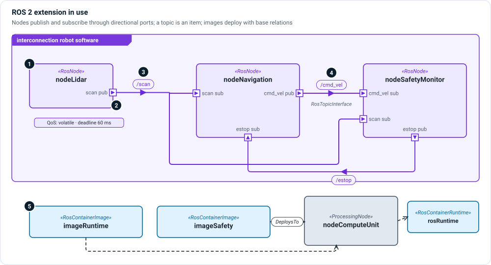

# ROS 2 extension

`memo_extension_ros` models software built on ROS 2 (Robot Operating System 2):
nodes, messages, topics, services, actions, quality of service, and
containerized deployment. It is the worked example of MEMO's extension rule:
a whole technology stack lands without a single new base relation.

```sysml
public import memo_extension_ros::*;   // also brings in messaging and container
```



1. **Nodes** — a `RosNode` is a `SoftwareComponent`, so it has the base timing
   attributes (period, WCET, safety class) plus `nodeNamespace`,
   `lifecycleManaged` and `executorModel`. `runtimeKind` is set per node: nodes
   composed into one process are threads; a safety monitor can be its own
   process.
2. **Directional ports** — `RosPublisher` is an `out` port and `RosSubscriber`
   an `in` port. Each names the `topic` it uses, its delivery semantics, and an
   offered or requested **QoS profile** (`RosQosProfile`: durability, deadline,
   liveliness, history depth).
3. **Topics are items** — a message type is an item definition
   (`RosMessage`); a named topic such as `/scan` is an item usage of it. The
   flow on a connector says which topic travels.
4. **Interfaces** — `RosTopicInterface` connects a publisher to a subscriber;
   `RosServiceInterface` connects a `RosServiceClient` to a `RosServiceServer`;
   `RosActionInterface` connects action client and server, with goal, feedback,
   result and cancel items and an action execution state machine.
5. **Deployment** — `RosContainerImage` and `RosContainerRuntime` specialize the
   container extension's kinds, so `BuildsInto`, `DeploysTo` and
   `ProvidesEnvironment` work unchanged.

## Kinds

| Kind | Specializes | Use it for |
|---|---|---|
| `RosNode` | `SoftwareComponent` | A ROS 2 node. |
| `RosMessage` | `MessagingMessage` | A message type; topics are its usages. |
| `RosPublisher`, `RosSubscriber` | `MessagingPublisher`, `MessagingSubscriber` | Topic endpoints, with QoS. |
| `RosTopicInterface` | `MessagingTopicInterface` | A publisher–subscriber connection. |
| `RosServiceClient`, `RosServiceServer`, `RosServiceInterface` | software ports / interface | Request–response services. |
| `RosActionClient`, `RosActionServer`, `RosActionInterface` | software ports / interface | Long-running actions with feedback. |
| `RosActionExecution` and its states | state definitions | The action lifecycle. |
| `RosQosProfile`, `RosDurabilityKind` | attribute / enum | QoS settings compared between ends. |
| `RosContainerImage`, `RosContainerRuntime` | `ContainerImage`, `ContainerRuntime` | Deployment. |

## Example

```sysml
part nodeLidar : RosNode {
    attribute :>> runtimeKind = RuntimeKind::thread;
    attribute :>> nodeNamespace = "/robot/perception";
    attribute :>> periodMs = 50 [milli*s];
    out port scanPublisher : RosPublisher {
        ref :>> topic = topicScan;
        attribute :>> deliverySemantics = MessagingDeliveryKind::atMostOnce;
        attribute :>> offeredQos {
            attribute :>> durability = RosDurabilityKind::volatile;
            attribute :>> deadlineMs = 60 [milli*s];
        }
    }
}

interface scanToNavigation : RosTopicInterface
    connect nodeLidar.scanPublisher to nodeNavigation.scanSubscriber;

allocation : BuildsInto allocate swNavigation to imageRuntime;
allocation runtimeImageDeployment : DeploysTo allocate imageRuntime to nodeComputeUnit {
    attribute :>> deploymentKind = DeploymentKind::containerized;
}
```

## Views

- An [interconnection view](../views/interconnection.md) of nodes, their ports
  and topic interfaces is the natural picture of a ROS graph.
- A [sequence view](../views/sequence.md) shows a service call or an action's
  goal–feedback–result exchange.
- An allocation [grid](../views/grid.md) shows which modules build into which
  image and where each image deploys.

Try it: `memo-architect --example ros-mobile-robot`.
