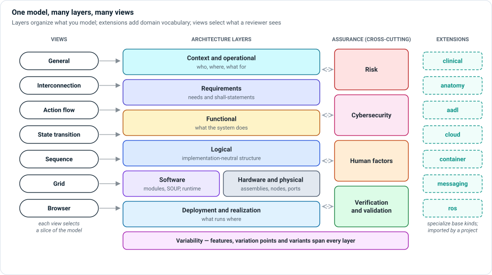

# Modeling with MEMO

This section explains **what you can model** with MEMO and **how each kind of
diagram shows it**. Read it when you are about to add content to a model, or
when you are reviewing a diagram and want to know what its symbols mean.

A MEMO model is a single SysML v2 source. Three ideas organize it:

| Idea | What it is | Where to read more |
|---|---|---|
| **Layers** | Groups of element kinds that answer one engineering question each: who uses the device, what it must do, how it is built, what can go wrong, and how you know it works. | [Layers](layers/index.md) |
| **Extensions** | Optional packages that add vocabulary for a domain or technology (ROS 2, AADL, cloud, clinical procedures, anatomy) by specializing the base kinds. | [Extensions](extensions/index.md) |
| **Views** | Diagrams, matrices and trees that select part of the model for one review. Every view is one of the eight SysML v2 view kinds. | [Views and diagrams](views/index.md) |

## How the three fit together

- You **author elements** in a layer, using the kinds that layer provides, and
  connect them with typed relationships. An element belongs to a layer because of
  its kind, not because of the folder its file is in.
- You **import an extension** when the base kinds are too general for your
  technology. Extension kinds specialize base kinds, so every rule, view and
  relationship that works for the base kind also works for them.
- You **define views** to show a slice of the model for a review. A view never
  copies the model: change an element once and every view that shows it updates.

## Where to start

| If you want to… | Read |
|---|---|
| Decide which kind an element should be | [Layers](layers/index.md), then the page for that layer |
| Trace a concern from need to evidence | [Following a concern across layers](layers/index.md#following-a-concern-across-layers) |
| Read an internal block diagram | [Interconnection views](views/interconnection.md) |
| Model a robot, a cloud service or a surgical procedure | [Extensions](extensions/index.md) |
| See the relationships that make up a traceability argument | [Connecting Elements](../users/relationships.md) |

!!! tip "Learn on the reference model"
    Every example in this section comes from, or is modeled on, the bundled GPCA
    infusion pump. Open it with `memo-architect --example gpca` and look up the
    element names used on these pages in the Model Explorer.

!!! note "About the figures"
    The figures in this section are illustrations drawn for the documentation.
    They use the same symbols as Architect's diagrams, but they are simplified and
    numbered so the text can point at each part. The diagrams Architect draws from
    your model look slightly different and carry more detail.
