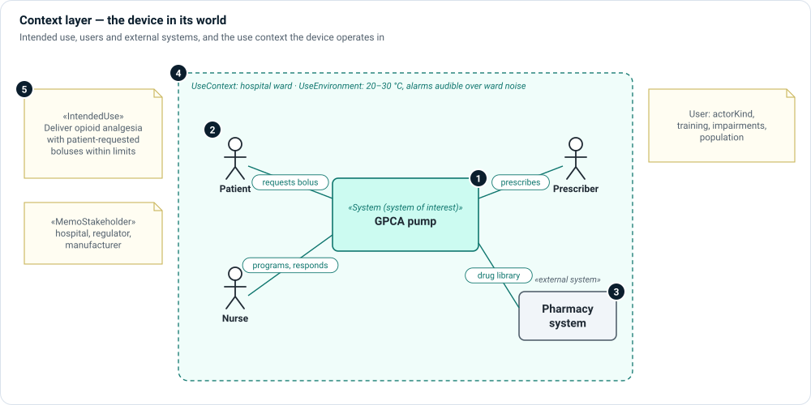

# Context layer

**The question:** who uses the device, where, for what, and alongside which
other systems?

The context layer draws the boundary. Everything inside it is your design;
everything outside is something your design must cope with. Regulators read it
first, because intended use and use environment decide which risks and
requirements apply.



1. **System of interest** — the device you are designing, seen as a black box.
   It is usually a `System` (or a definition that specializes it, such as the
   `ProductSystem` an `init` project starts with).
2. **Users** — people who interact with the device, modeled as `User` parts. Set
   `actorKind` (patient, clinician, caregiver, technician, administrator) and the
   attributes a usability engineer needs: training, qualification, impairments,
   population.
3. **External systems and devices** — non-human participants such as a pharmacy
   server or an IV set. They are outside the boundary; the lines to them are the
   exchanges your interfaces must support.
4. **Use context and environment** — `UseContext` records the care setting,
   jurisdiction and whether use is connected; `UseEnvironment` records physical
   conditions. `SituatedIn` joins the two.
5. **Intended use and stakeholders** — `IntendedUse` states indication,
   contraindication and patient population. `MemoStakeholder` lists the parties
   whose concerns the model must answer.

## Kinds

| Kind | Use it for |
|---|---|
| `IntendedUse` | The medical purpose, indications and contraindications. One per device. |
| `User` | A human role that operates or is treated by the device. |
| `UseContext` | Where the device is used: care setting, jurisdiction, connected use. |
| `UseEnvironment` | Physical and environmental conditions of use. |
| `MemoStakeholder` | A party with concerns: patient, hospital, regulator, manufacturer. |
| `ArchitectureDescription`, `CorrespondenceRule` | ISO/IEC/IEEE 42010 bookkeeping, when you need it. |

## Relationships

| Relationship | Meaning |
|---|---|
| `InteractsInContext` | A participant interacts with the system in a use context. |
| `SituatedIn` | A use context takes place in a use environment. |
| `AppliesInContext` | Something (a requirement, a risk) applies only in a given context. |
| `RequiresCapability` | The intended use requires an operational capability. |
| `HeldBy` | A need is held by a stakeholder or user. |

## Example

```sysml
requirement gpcaIntendedUse : IntendedUse {
    @MemoIdentity { :>> providedId = "IU-001"; }
    attribute :>> indication = "Management of acute post-operative or chronic pain requiring titrated intravenous opioid analgesia.";
    attribute :>> patientPopulation = "Adult in-patients under clinical supervision.";
}

part actorPatient : User {
    attribute :>> actorKind = ActorKind::patient;
    @MemoIdentity { :>> providedId = "ACT-001"; :>> label = "Patient"; }
    attribute :>> trainingLevel = "instructed by clinician on bolus request button only";
}

part hospitalWardContext : UseContext {
    @MemoIdentity { :>> providedId = "UC-001"; :>> label = "HospitalWardUseContext"; }
    attribute :>> careSetting = "acute-care hospital ward and post-anesthesia care unit";
    attribute :>> connectedUse = true;
}
```

## In Architect

- A **context view** (`diagramType = "context"`) draws the system of interest in
  the middle with users and external systems around it. Set the view's
  `subjectElement` to the system of interest. See
  [Use case and context views](../views/use-case-and-context.md).
- The Model Explorer lists these kinds under **Architecture › Operational**.

## Review checklist

- Is every user named in the intended use modeled as a `User`?
- Does every line crossing the boundary correspond to an interface you will
  design or a reason it needs none?
- Is the use environment specific enough to drive requirements (temperature,
  noise, lighting, connectivity)?
