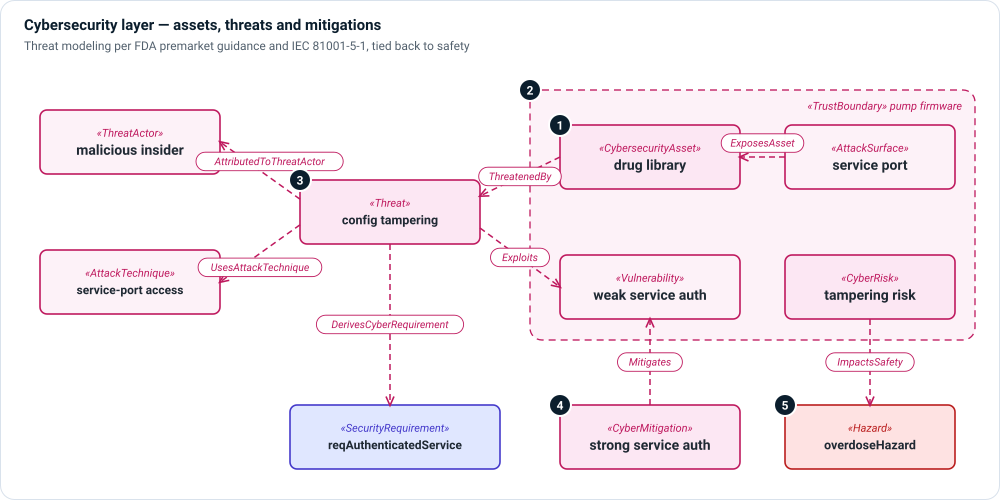

# Cybersecurity layer

**The question:** what could be attacked, by whom and how, and what protects
it—including where a successful attack would become a safety problem?

The cybersecurity layer supports threat modeling as the FDA premarket
cybersecurity guidance and IEC 81001-5-1 expect it, and ties the result back to
the risk layer so that safety and security are argued together.



1. **Assets and attack surfaces** — a `CybersecurityAsset` is something worth
   protecting (a drug library, therapy settings, patient data); an
   `AttackSurface` `ExposesAsset` to the outside. `SecurityProperty` records the
   confidentiality, integrity or availability objective.
2. **Trust boundaries** — a `TrustBoundary` marks where trust changes, such as
   the edge of the pump firmware or of the manufacturer's cloud.
3. **Threats** — a `Threat` is attributed to a `ThreatActor`, uses an
   `AttackTechnique` (with a framework reference such as MITRE ATT&CK), and
   `Exploits` a `Vulnerability`. An asset is `ThreatenedBy` the threat.
4. **Mitigations and requirements** — a `CyberMitigation` `Mitigates` a
   vulnerability; a `SecurityRequirement` derives from the threat with
   `DerivesCyberRequirement`.
5. **Safety impact** — `ImpactsSafety` ties a cyber risk or threat to the
   hazard it could cause, so the safety risk analysis sees it.

The layer also covers assessment and postmarket work: `CyberRisk`,
`CyberRiskAssessment`, `AttackPath`, `SecurityAssessmentCase`,
`SecurityFinding`, `SecurityAssessmentReport`, `CybersecurityAssumption`, and
monitoring of SBOM entries (`AffectsSBOMEntry`, `MonitorsSBOMEntry`).

## Kinds

| Kind | Use it for |
|---|---|
| `CybersecurityAsset`, `SecurityProperty` | What to protect and which property matters. |
| `AttackSurface`, `TrustBoundary` | Where an attacker can reach the system. |
| `ThreatActor`, `AttackTechnique`, `Threat`, `AttackPath` | Who attacks, how, and along which path. |
| `Vulnerability`, `CyberHazard` | Weaknesses and the hazards they create. |
| `CyberRisk`, `CyberRiskAssessment` | Estimation and assessment. |
| `CyberMitigation`, `SecurityRequirement` | Controls and the requirements they produce. |
| `SecurityAssessmentCase`, `SecurityFinding`, `SecurityAssessmentReport` | Testing and its results. |

## Relationships

| Relationship | Meaning |
|---|---|
| `ThreatenedBy` | This asset is threatened by this threat. |
| `AttributedToThreatActor`, `UsesAttackTechnique` | This threat comes from this actor, using this technique. |
| `Exploits` | This threat exploits this vulnerability. |
| `ExposesAsset` | This attack surface exposes this asset. |
| `Mitigates` | This mitigation mitigates this vulnerability. |
| `DerivesCyberRequirement` | This requirement derives from this threat or cyber risk. |
| `ImpactsSafety` | This cyber element could lead to this safety hazard. |
| `CrossesTrustBoundary` | This exchange crosses a trust boundary. |
| `IdentifiesVulnerability`, `AffectsSBOMEntry`, `MonitorsSBOMEntry` | Findings and SBOM monitoring. |

## Example

```sysml
connection : Mitigates
    connect control ::> strongServiceAuthentication
    to mitigatedElement ::> weakServiceAuthentication {
    attribute :>> mitigationKind = MitigationKind::vulnerability;
}

connection : DerivesCyberRequirement
    connect sourceThreatOrRisk ::> unauthorizedConfigChangeThreat
    to targetRequirement ::> reqAuthenticatedServiceAccess;
```

## In Architect

- A **threat model** view (`threat-model`) is a [general view](../views/general.md)
  of assets, threats and mitigations.
- The cybersecurity viewpoint also carries document views for the threat model
  and the cybersecurity assessment; **☰ › Model › Documents** generates them.

## Review checklist

- Is every asset behind a trust boundary, and every crossing of that boundary
  modeled?
- Does every threat that could affect safety have an `ImpactsSafety` link and a
  corresponding hazard?
- Is every mitigation verified by a security assessment case?
