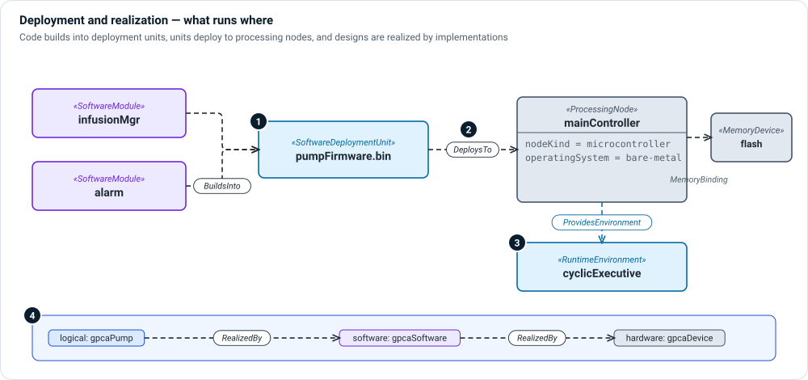

# Deployment and realization layer

**The question:** what runs where, and which implementation realizes which
part of the design?

This layer joins software to hardware and design to implementation. It is
small, but it is where many review questions are answered: which firmware
image runs on the safety processor, which binary contains a SOUP library, and
whether the logical architecture is fully realized.



1. **Deployment units** — `SoftwareDeploymentUnit` is a built artifact: a
   firmware image, an installer, a container image. Software modules
   `BuildsInto` it.
2. **Deploys to** — a deployment unit `DeploysTo` a processing node. Set
   `deploymentKind` (native, embedded, containerized,
   partitioned, cloud-hosted) on the allocation.
3. **Runtime environments** — a processing node `ProvidesEnvironment` such as
   an RTOS, a cyclic executive or a container runtime.
4. **Realization** — `RealizedBy` says that a logical element is realized by
   software, hardware or both, so a reviewer can check nothing logical is left
   unrealized.

For timing and data-path arguments, `FlowSpecification` and `EndToEndFlow`
describe a path through the system, and `FlowTraversesBinding`,
`MemoryBinding` and `ConnectionBinding` record which resources it uses.

## Kinds and relationships

| Element | Kind | Meaning |
|---|---|---|
| `SoftwareDeploymentUnit` | part def | A built, deployable artifact. |
| `RuntimeEnvironment` | part def | What a node provides for software to run in. |
| `FlowSpecification`, `EndToEndFlow` | part def | A specified end-to-end path and its budget. |
| `BuildsInto` | allocation def | This module is built into this deployment unit. |
| `DeploysTo` | allocation def | This deployment unit runs on this node. |
| `RealizedBy` | allocation def | This design element is realized by that implementation. |
| `ProvidesEnvironment` | connection def | This node provides this runtime environment. |
| `MemoryBinding`, `ConnectionBinding`, `FlowTraversesBinding` | allocation def | Resource bindings for timing and data-path analysis. |

## Example

```sysml
allocation deviceRealizesPump : RealizedBy allocate gpcaPump to gpcaDevice;
allocation softwareRealizesPump : RealizedBy allocate gpcaPump to gpcaSoftware;

part pumpFirmware : SoftwareDeploymentUnit;
allocation : BuildsInto allocate gpcaSoftware.infusionMgr to pumpFirmware;
allocation : DeploysTo allocate pumpFirmware to mainController;
```

Extensions reuse these relations unchanged. A ROS 2 container image is a
`SoftwareDeploymentUnit`, so it `BuildsInto` and `DeploysTo` exactly as a
firmware image does. See the [ROS 2 extension](../extensions/ros.md).

## In Architect

- An **allocation** grid (`alloc`) shows modules against deployment units, or
  deployment units against nodes. See [Grid views](../views/grid.md).
- A **network topology** view of the physical viewpoint shows the nodes the
  software deploys to.

## Review checklist

- Is every software module built into exactly the deployment units you expect?
- Does every deployment unit deploy to a node, and does that node provide a
  runtime environment the unit needs?
- Is every logical component realized by something?
