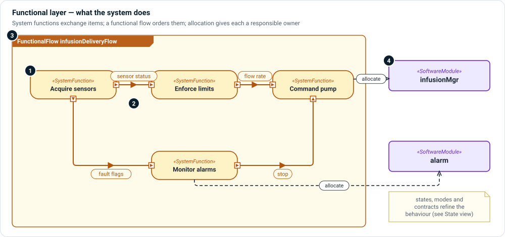

# Functional layer

**The question:** what does the system do, in what order, and which part is
responsible for each function?

Functions describe transformation—inputs become outputs—without saying what
hardware or code does the work. Keeping them separate from components lets you
reason about behavior first, and then check that every function has an owner.



1. **Functions** — `SystemFunction` for what the system as a whole does;
   `ComponentFunction` for what one component does. Give each a trigger, an output
   description, a concern and a criticality.
2. **Functional exchanges** — items passed between functions through pins
   (`in` / `out` parameters). A `FunctionalTransfer` is a flow of an item from one
   function's output to another's input.
3. **Functional flow** — a `FunctionalFlow` orders functions into a chain for a
   scenario, with successions, decisions and parallel branches.
4. **Allocation** — SysML's `allocate` gives each function a responsible
   logical component, software module or hardware element.

Behavior beyond ordering lives here too: a `StateMachine` for modes,
`ModeConfiguration` for what is active in each mode, and `Contract`,
`BehaviorProperty` and constraint definitions (for example
`MaxResponseTimeConstraint`) for properties a verification case can check.

## Kinds

| Kind | Use it for |
|---|---|
| `SystemFunction`, `ComponentFunction` | A transformation the system or a component performs. |
| `FunctionalFlow` | An ordered chain of functions for one scenario. |
| `FunctionalTransfer` | An item flowing from one function to another. |
| `ActivityAction`, `ActivityFlow` | Lower-level activities inside a function. |
| `StateMachine`, `ModeConfiguration` | Modes and what each mode enables. |
| `Contract`, `BehaviorProperty`, `TimingConstraint` | Assume/guarantee contracts and temporal properties. |

## Relationships

| Relationship | Meaning |
|---|---|
| `allocate … to …` (native) | This element is responsible for this function. |
| `flow … from … to …` (native) | This item flows between these pins. |
| `succession` / `first … then …` (native) | This action follows that one. |
| `satisfy` (native) | This function satisfies this requirement. |

## Example

```sysml
action fnEnforceLimits : SystemFunction {
    @MemoIdentity { :>> providedId = "FUNC-006"; :>> label = "EnforceDoseLimits"; }
    attribute :>> trigger = "patient bolus request or clinician square bolus command";
    attribute :>> outputDescription = "Bolus authorized or rejected against lockout interval and hourly maximum";
    attribute :>> criticality = CriticalityKind::catastrophic;
}

action fnCommandPump : SystemFunction {
    @MemoIdentity { :>> providedId = "FUNC-007"; :>> label = "CommandPumpMotor"; }
    in flowCommandIn : InterfaceItem;
}

allocate infusionDeliveryFlow.acquireSensors to gpcaDevice.gpcaDeviceSensors;
```

## In Architect

- A **function flow diagram** (`ffd`) and an **activity diagram** (`act`, `afd`)
  are [action flow views](../views/action-flow.md).
- A **state machine diagram** (`stm`) is a
  [state transition view](../views/state-transition.md).
- A **function allocation** grid (`alloc`) shows which element owns each
  function. See [Grid views](../views/grid.md).

## Review checklist

- Does every function have a single, named responsible element?
- Are the items exchanged between functions named and typed, not just arrows?
- Are safety functions (monitoring, shutdown) modeled as functions in their own
  right, so they can be allocated to independent parts?
