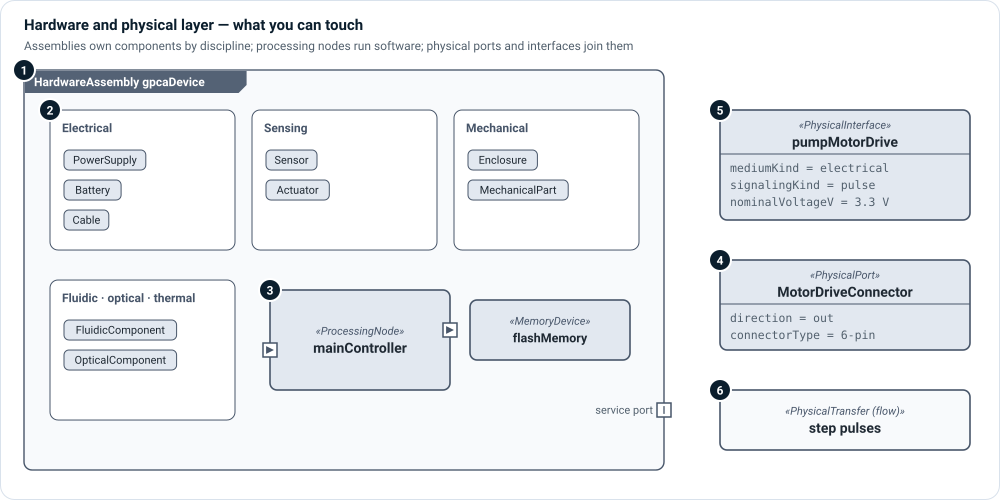

# Hardware and physical layer

**The question:** which physical parts realize the design, and how are they
connected?

This layer describes what you can touch: assemblies and the components inside
them, the processors that run software, and the connectors and cables that join
them. Its interfaces carry energy, signals and material as well as data.



1. **Assemblies** — `HardwareAssembly`, `PhysicalAssembly` and
   `PhysicalSubassembly` own the components below them.
2. **Components by discipline** — electrical (`PowerSupply`, `Battery`,
   `Cable`, `ElectronicComponent`), sensing (`Sensor`, `Actuator`), mechanical
   (`Enclosure`, `MechanicalPart`), fluidic, pneumatic, optical, acoustic and
   thermal components. Pick the most specific kind; a general
   `HardwareComponent` is always available.
3. **Processing nodes and memory** — `ProcessingNode` (microcontroller, SoC,
   FPGA, DSP, gateway, edge device, cloud server) with architecture, memory, operating system and safety
   partitioning; `MemoryDevice` for storage.
4. **Physical ports** — `PhysicalPort`s on component boundaries, with a direction
   and a `connectorType`.
5. **Physical interfaces** — a `PhysicalInterface` connects two physical ports and
   records medium, signaling, protocol, voltage and current.
6. **Physical flows** — `PhysicalTransfer` names what travels over the interface:
   power, a pulse train, an analog pressure signal, fluid.

## Kinds

| Kind | Use it for |
|---|---|
| `HardwareAssembly`, `PhysicalAssembly`, `PhysicalSubassembly` | Containers of physical parts. |
| `HardwareComponent`, `PhysicalComponent` | A general physical part. |
| `ElectricalComponent`, `ElectronicComponent`, `PowerSupply`, `Battery`, `Cable`, `PhysicalConnectorPart`, `NetworkMedium` | Electrical parts. |
| `Sensor`, `Actuator` | Sensing and actuation. |
| `MechanicalPart`, `Enclosure` | Mechanical parts. |
| `FluidicComponent`, `PneumaticComponent`, `OpticalComponent`, `AcousticComponent`, `ThermalComponent` | Other disciplines. |
| `ProcessingNode`, `MemoryDevice` | Compute and storage. |
| `PhysicalPort`, `PhysicalInterface`, `PhysicalTransfer` | Connection points, connections and what flows. |

## Relationships

| Relationship | Meaning |
|---|---|
| Part ownership (native) | This component is inside that assembly. |
| `interface … connect … to …` (native) | These two physical ports are joined by this interface. |
| `flow` (native) | This item flows over the connection. |
| `RealizedBy` | This logical element is realized by this hardware. |
| `DeploysTo` | This deployment unit runs on this processing node (see [Deployment](deployment.md)). |

## Example

```sysml
part mainController : ProcessingNode {
    @MemoIdentity { :>> providedId = "PN-001"; :>> label = "MainControllerMCU"; }
    attribute :>> nodeKind = ProcessingNodeKind::microcontroller;
    attribute :>> processorArchitecture = "ARM Cortex-M4, lockstep-capable";
    attribute :>> safetyPartition = true;
}

out port portMotorDrive : PhysicalPort {
    @MemoIdentity { :>> providedId = "PP-002"; :>> label = "MotorDriveConnector"; }
    attribute :>> portKind = InterfaceKind::digitalSignal;
    attribute :>> connectorType = "keyed 6-pin locking header with enable interlock";
}

interface pumpMotorDrive : PhysicalInterface
    connect portMotorDrive to pumpMotorAssembly.portFlowCommandIn {
    @MemoIdentity { :>> providedId = "PI-002"; :>> label = "PumpMotorStepDrive"; }
    attribute :>> mediumKind = PhysicalMediumKind::electrical;
    attribute :>> signalingKind = SignalingKind::pulse;
    attribute :>> nominalVoltageV = 3.3 [V];
}
```

## In Architect

- A **physical IBD** is the main view of this layer. The
  [Interconnection views](../views/interconnection.md) page explains how to read
  one: parts, ports, connectors and the flows over them.
- A **bill-of-materials** view (`VIEW-PHY-001`) and a **network topology** view
  (`VIEW-PHY-002`) come with the physical viewpoint.
- **☰ › Views › Interfaces** lists every interface between two parts.

## Review checklist

- Does every physical port have a direction and a connector type?
- Does every interface say what flows over it, with units?
- Is every processing node the target of at least one deployment, and every
  deployment unit deployed somewhere?
