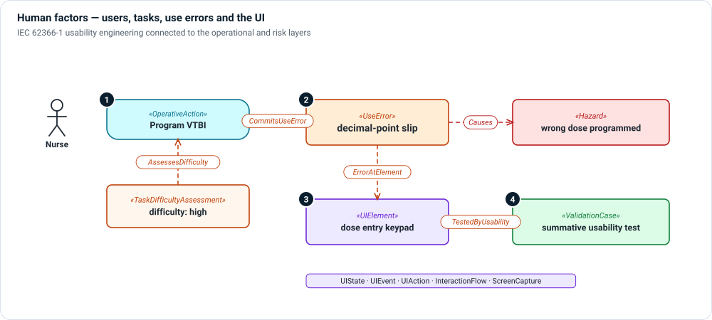

# Human factors layer

**The question:** how could a user get a task wrong, where in the user interface
would it happen, and how do you show it is controlled?

Human factors (IEC 62366-1 usability engineering) connects three other layers:
the operational tasks users perform, the user interface they use, and the
hazards a use error can cause.

1. **Tasks and difficulty** — tasks are the `OperativeAction`s of the
   [operational layer](operational.md). A `TaskDifficultyAssessment`
   `AssessesDifficulty` of a task, so critical tasks stand out.
2. **Use errors** — a task `CommitsUseError`; the `UseError` records what goes
   wrong. A `Causes` link (with `causeKind = useErrorLeadsToHazard`) or a
   `TracesRisk` link connects it to the risk chain.
3. **The user interface** — the use error happens `ErrorAtElement` of a
   `UIElement` or `OperatorInterfaceElement`. UI states, events, actions and
   interaction flows describe the screens.
4. **Usability validation** — a UI element or task is `TestedByUsability` in a
   formative or summative `ValidationCase`.

## Kinds

| Kind | Use it for |
|---|---|
| `UseError` | An action or lack of action that leads to a different result than intended. |
| `TaskDifficultyAssessment` | How hard a task is, and why. |
| `UserInterface`, `UIElement`, `OperatorInterfaceElement` | The interface and its elements. |
| `UIState`, `UIEvent`, `UIAction`, `InteractionFlow` | How the interface behaves. |
| `ScreenCapture` | A screenshot whose regions map to UI elements. |

## Relationships

| Relationship | Meaning |
|---|---|
| `CommitsUseError` | Performing this task can produce this use error. |
| `AssessesDifficulty` | This assessment rates this task. |
| `ErrorAtElement` | This use error happens at this UI element. |
| `ElementTriggersAction`, `NavigatesTo` | This element triggers this action; this screen leads to that one. |
| `CapturesScreen` | This screen capture shows this UI state. |
| `TestedByUsability` | This element or task is tested in this usability case. |
| `ControlImplementedBy` | This risk control is implemented by this UI element. |

## In Architect

- **☰ › Views › UI Screens** loads screen captures, detects regions, lets you
  label each as a `UIElement` and accept it into the model. Each region links to
  its traceability.
- A **usability engineering** view comes with the usability viewpoint, and
  **☰ › Model › Documents** generates the usability engineering file.

## Review checklist

- Is every hazard-related use scenario linked to the tasks it involves?
- Does every critical task have a summative validation case?
- Are risk controls that rely on the UI (a confirmation screen, a limit
  warning) linked to the UI element that implements them?
