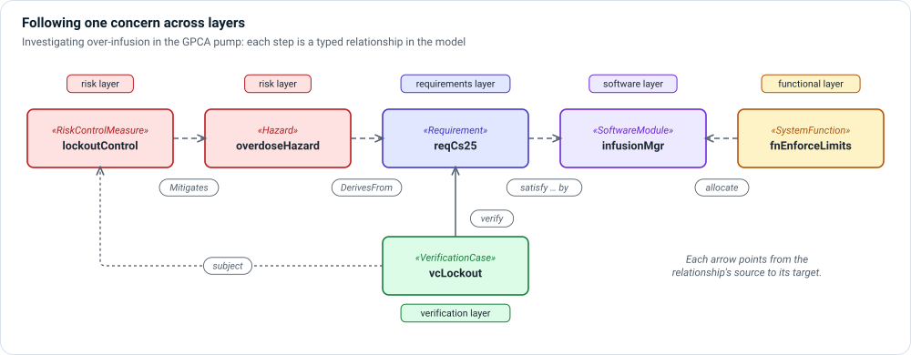

# Layers

A layer groups the element kinds that answer one engineering question. Layers
make a large model understandable: a reviewer who asks "what can go wrong?" looks
at the risk layer, and one who asks "what runs on this processor?" looks at
deployment.

Layers are **not project phases**. You will usually add a little to several
layers at once—one need, one requirement, one function, one hazard, one test—and
then grow each of them.

## The layers

| Layer | The question it answers | Typical kinds |
|---|---|---|
| [Context](context.md) | Who uses the device, where, and alongside what? | `IntendedUse`, `User`, `UseContext`, `UseEnvironment`, `MemoStakeholder` |
| [Operational](operational.md) | What work do people do, and which outcomes matter? | `UseCase`, `OperationalWorkflow`, `OperativeScenario`, `OperativeAction`, `OperationalCapability` |
| [Requirements](requirements.md) | What must be true, measurably? | `Need`, `Requirement`, `SystemConstant`, `TimingConstraint` |
| [Functional](functional.md) | What does the system do, and in what order? | `SystemFunction`, `ComponentFunction`, `FunctionalFlow`, `FunctionalTransfer`, `StateMachine` |
| [Logical](logical.md) | Which implementation-neutral parts carry the responsibility? | `System`, `Subsystem`, `LogicalComponent`, `LogicalPort`, `LogicalInterface` |
| [Software](software.md) | Which code realizes the design? | `SoftwareSystem`, `SoftwareModule`, `SOUPSoftwareModule`, `SoftwareComponent`, `SoftwareBillOfMaterials` |
| [Hardware and physical](hardware-physical.md) | Which physical parts realize the design, and how are they wired? | `HardwareAssembly`, `Sensor`, `Actuator`, `ProcessingNode`, `PhysicalPort`, `PhysicalInterface` |
| [Deployment and realization](deployment.md) | What runs where, and what realizes what? | `SoftwareDeploymentUnit`, `RuntimeEnvironment`, `DeploysTo`, `BuildsInto`, `RealizedBy` |
| [Risk](risk.md) | What could cause harm, and how is it controlled? | `HazardCause`, `Hazard`, `HazardousSituation`, `Harm`, `Risk`, `RiskControlMeasure` |
| [Cybersecurity](cybersecurity.md) | What could be attacked, and how is it protected? | `CybersecurityAsset`, `Threat`, `Vulnerability`, `CyberRisk`, `CyberMitigation` |
| [Human factors](human-factors.md) | How could a user get it wrong, and where in the UI? | `UseError`, `TaskDifficultyAssessment`, `UserInterface`, `UIElement` |
| [Verification and validation](verification.md) | How do we know each claim holds? | `VerificationCase`, `ValidationCase`, `TestStep`, `TestRun`, `MemoEvidence` |
| [Variability](variability.md) | Where does a product family differ, and why? | `ProductFeature`, variation points and variants, release records |

The first eight are the **architecture** layers: they describe the device. Risk,
cybersecurity, human factors and verification are **assurance** layers: they
argue that the device is acceptably safe and effective, and they connect to
every architecture layer. Variability cuts across all of them.

## Following a concern across layers

A good model lets a reviewer start anywhere and follow typed relationships to
the rest of the argument. Investigating over-infusion in the GPCA pump, the
reviewer finds the control that mitigates the hazard, the requirement derived
from the hazard, the software module that satisfies the requirement and the
function allocated to that module, and the verification case that verifies the
requirement while exercising the control.

In Architect:

1. Find the element in the **Model Explorer** (☰ › Model › Architecture or
   Assurance).
2. Read its incoming and outgoing relationships in the Properties panel.
3. Open a view that shows the neighborhood you care about—a risk chain, a
   requirements trace, an interconnection diagram.
4. Switch views when the question changes, not when the diagram gets crowded.

## How Architect decides an element's layer

The **kind** of an element decides its layer. A `Hazard` is in the risk layer
whether its file is `risk.sysml` or `misc.sysml`. Folders and packages are for
ownership and review convenience; the Model Explorer groups by kind first and
then, if you switch it on, by package.

The layers a project uses come from its methodology. **Settings › Model ›
Methodology** shows the layers and extensions the model uses, and lets a
methodology owner change them.

## Next

Each layer page shows a figure of what you can model, the kinds and
relationships available, a short SysML example, and how the layer appears in
Architect. To see how the same content looks in each diagram type, read
[Views and diagrams](../views/index.md).
