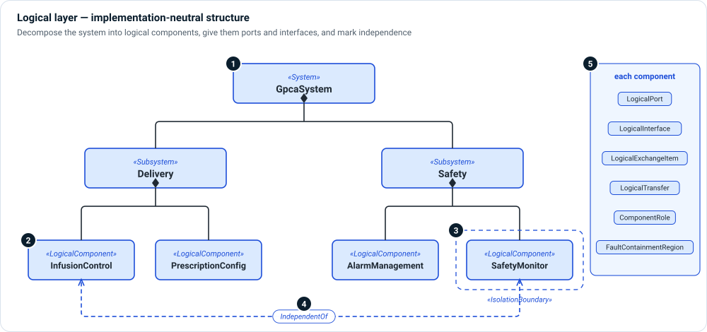

# Logical layer

**The question:** which implementation-neutral parts carry the device's
responsibilities, and how do they talk to each other?

The logical architecture decomposes the system into components that own
responsibilities, without yet deciding whether each becomes software, hardware
or both. It is where you argue independence and fault containment, before a
technology choice makes that argument harder to change.



1. **System** — the root of the logical decomposition. A `SystemOfSystems` can
   group several systems.
2. **Subsystems and logical components** — `Subsystem` and `LogicalComponent`
   parts, each with a stated `responsibility`, `decompositionLevel` and, where it
   matters, a `safetyPartition`.
3. **Isolation boundaries** — `IsolationBoundary` and `FaultContainmentRegion`
   mark where a fault must stop.
4. **Independence** — `IndependentOf` records that two channels must not share a
   failure cause, which a safety argument (and a reviewer) can then check.
5. **Interfaces** — each component exposes `LogicalPort`s, connected by
   `LogicalInterface`s that carry `LogicalExchangeItem`s. See the
   [logical interconnection view](../views/interconnection.md#logical-interconnection).

## Kinds

| Kind | Use it for |
|---|---|
| `SystemOfSystems`, `System`, `Subsystem` | The decomposition hierarchy. |
| `LogicalComponent` | A responsibility-owning part. |
| `LogicalPort`, `DataPort`, `CommandPort`, `SensorPort` | Interaction points on a component. |
| `LogicalInterface`, `ComponentExchange` | The connection type between two ports. |
| `LogicalExchangeItem`, `InterfaceItem` | What travels over an interface. |
| `LogicalTransfer` | A flow of an exchange item. |
| `IsolationBoundary`, `FaultContainmentRegion` | Where faults are contained. |
| `DesignDecision` | A recorded choice between alternatives. |

## Relationships

| Relationship | Meaning |
|---|---|
| Part ownership (native) | This component is part of that one. |
| `LogicalConnector` | This component sends content of a `contentKind` (command, data, energy) to that one. |
| `interface … connect … to …` (native) | These two ports are joined by a typed interface. |
| `IndependentOf` | These two channels must not share a failure cause. |
| `allocate` (native) | This component owns this function. |
| `RealizedBy` | This logical element is realized by software or hardware. |

## Example

```sysml
part gpcaPump : System {
    part lcTherapyControl : LogicalComponent {
        @MemoIdentity { :>> providedId = "LC-001"; :>> label = "TherapyControlSubsystem"; }
        attribute :>> responsibility = "Owns therapy state, prescription execution, and dose limiting.";
        attribute :>> safetyPartition = "safety-critical partition";
    }
    part lcSafetyMonitoring : LogicalComponent {
        @MemoIdentity { :>> providedId = "LC-002"; :>> label = "SafetyMonitoringSubsystem"; }
        attribute :>> responsibility = "Detects exceptional conditions and drives the pump to a safe state.";
    }
    connection : LogicalConnector
        connect sourceComponent ::> lcTherapyControl
        to targetComponent ::> lcDrugDelivery {
        attribute :>> contentKind = FlowContentKind::command;
    }
}
```

## In Architect

- A **block definition diagram** (`bdd`) of the logical decomposition is a
  [general view](../views/general.md).
- A **logical IBD** (`ibd`) shows ports, interfaces and exchanges. See
  [Interconnection views](../views/interconnection.md).
- **☰ › Views › Interfaces** lists every interface between two parts you pick,
  of any kind or layer. `memo-architect interfaces <a> <b>` does the same from a
  terminal.
- **☰ › Advanced › Design Structure Matrix** shows dependencies between
  components. See [Grid views](../views/grid.md).

## Review checklist

- Does every logical component have a one-sentence responsibility?
- Is every safety function allocated to a component inside the right isolation
  boundary?
- Are independence claims modeled with `IndependentOf`, not only written in prose?
