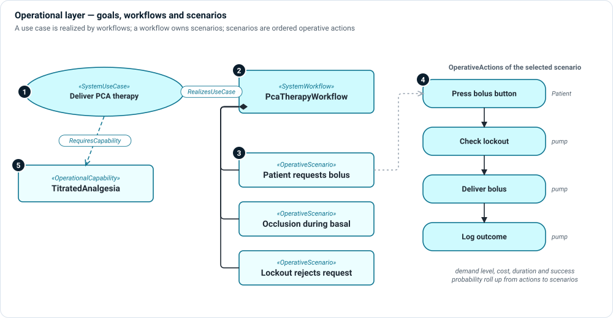

# Operational layer

**The question:** what work do people do with the device, and which outcomes
matter to them?

The operational layer describes use before design. It starts with goals (use
cases), shows how work is organized to reach them (workflows), and picks out the
concrete paths that need analysis (scenarios), each an ordered list of actions.



1. **Use case** — an actor's goal: "Deliver PCA therapy". Use `ClinicalUseCase`
   for clinical goals and `SystemUseCase` for goals the system serves. Set the
   goal, trigger and success outcome, and name the actors.
2. **Workflow** — how the work is organized: `ClinicalWorkflow` or
   `SystemWorkflow`, with entry and completion conditions. A workflow
   **realizes** a use case.
3. **Scenarios** — selected paths through a workflow, as `OperativeScenario`
   actions owned by the workflow: the nominal path, alternatives and failure
   paths. `scenarioKind` marks a path nominal or alternate.
4. **Operative actions** — the ordered steps of a scenario. Each step can name
   its performer, demand level, cost, duration and success probability; MEMO's
   roll-up calculations add them up to the scenario.
5. **Capabilities** — `OperationalCapability` names an ability the intended use
   requires, independent of any one workflow.

## Kinds

| Kind | Use it for |
|---|---|
| `ClinicalUseCase`, `SystemUseCase` | A goal; group use cases by declared level. |
| `ClinicalWorkflow`, `SystemWorkflow` | The organized work that reaches a goal. |
| `OperativeScenario` | One path through a workflow. |
| `OperativeAction` | One step: who does it, how hard it is, how long it takes. |
| `OperationalCapability` | An ability the device must provide. |
| `OperationalEntity` | A thing in the operational world (a drug reservoir, a ward). |
| `WorkflowResource` | Staff, equipment or material a workflow consumes. |

## Relationships

| Relationship | Meaning |
|---|---|
| `RealizesUseCase` | A workflow realizes a use case. |
| `Motivates` | A need motivates a use case. |
| `EnablesUseCase` | A capability enables a use case. |
| `RequiresCapability` | The intended use requires a capability. |
| `include` / `extend` (native) | One use case includes or extends another. |

## Example

```sysml
use case ucDeliverPcaTherapy : SystemUseCase {
    attribute :>> useCaseKind = UseCaseKind::care;
    @MemoIdentity { :>> providedId = "UC-001"; :>> label = "DeliverPatientControlledAnalgesia"; }
    attribute :>> goalStatement = "Deliver prescribed analgesia safely while allowing patient-controlled bolus requests within configured limits.";
    subject supportingSystem;
    actor patientActor = actorPatient;
    actor nurseInitiator = actorNurse;
}

part wfManageActiveTherapy : SystemWorkflow {
    @MemoIdentity { :>> label = "ManageActiveTherapy"; }
    attribute :>> entryCondition = "Basal therapy is active.";
    action osNominalTherapy : OperativeScenario {
        @MemoIdentity { :>> providedId = "OS-001"; :>> label = "NominalTherapySession"; }
        attribute :>> pathSummary = "Program and confirm > start basal > patient boluses within limits > stop therapy";
    }
}

connection : RealizesUseCase
    connect realizingWorkflow ::> wfManageActiveTherapy
    to realizedUseCase ::> ucDeliverPcaTherapy;
```

## In Architect

- **☰ › Views › Use Cases** lists use cases grouped by declared level, with each
  use case's workflows and scenarios. Select a scenario to see it as an
  operational flow (`ofd`). Variants of a flow show as rows you can switch between.
- A **use case diagram** (`ucd`) shows actors and goals. See
  [Use case and context views](../views/use-case-and-context.md).
- Operational flows are [action flow views](../views/action-flow.md) with
  swimlanes for performers.

## Review checklist

- Does every leaf use case have at least one workflow that realizes it?
- Are failure and alternative scenarios modeled, not only the nominal path?
- Can every operative action be traced to a function that supports it, or is it
  purely human work?
