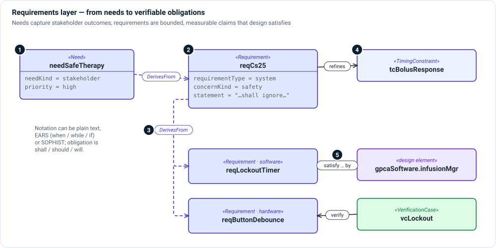

# Requirements layer

**The question:** what must be true about the device, in terms someone can
verify?

The requirements layer separates what stakeholders **need** from what the
device **shall** do. A need is an outcome in the stakeholder's language; a
requirement is a bounded, measurable obligation derived from needs, hazards,
threats or standards.



1. **Need** — a stakeholder outcome. Set `needKind` (stakeholder, user,
   clinical user, patient user, business, regulatory…) and priority.
2. **Requirement** — a shall-statement. `requirementType` says whether it is a
   system, software, hardware or IFU requirement; `concernKind` says which
   concern (safety, security, performance…) it addresses.
3. **Derivation** — `DerivesFrom` links a requirement to what drove it: a need,
   a risk control, a threat or a parent requirement. This is how lower-level
   requirements inherit their reason for existing.
4. **Constraints** — `TimingConstraint`, `BehaviorProperty`, `Contract` and
   constraint definitions make a requirement precise enough to check
   automatically.
5. **Satisfaction and verification** — the design answers a requirement with
   SysML's `satisfy`, and a verification case checks it with `verify`.

## Kinds

| Kind | Use it for |
|---|---|
| `Need` | A stakeholder outcome; one kind with a `needKind` attribute. |
| `Requirement` | A system, software, hardware or IFU obligation. |
| `SecurityRequirement` | A requirement that comes from threat modeling. |
| `SystemConstant` | A named constant the requirements refer to (a limit, a default). |
| `NotificationSpec` | An alarm or notification: priority, audio/visual, what it inhibits. |
| `TimingConstraint`, `BehaviorProperty`, `Contract` | Precise, checkable refinements. |
| `RiskDriver` | A requirement driver that comes from risk. |

A requirement can be written in plain text, in **EARS** (when / while / if /
where) or in **SOPHIST** form. Set `notation`, `earsPattern` and `obligation`
(shall / should / will), and Architect shows the parsed clauses.

## Relationships

| Relationship | Meaning |
|---|---|
| `DerivesFrom` | This requirement is driven by that need, control, threat or parent requirement. |
| `satisfy … by …` (native) | This design element satisfies this requirement. |
| `verify` in a verification case objective (native) | This case checks this requirement. |
| `Validates` | This validation case validates this need. |
| `#refinement dependency` (native) | This constraint refines this requirement. |
| `ConformsTo`, `TracesToDocument` | This element conforms to a standard clause or traces to a document. |

## Example

```sysml
requirement needSafeTherapy : Need {
    attribute :>> needKind = NeedKind::'stakeholder';
    @MemoIdentity { :>> providedId = "NEED-001"; :>> label = "SafePatientControlledTherapy"; }
    attribute :>> statement = "The device shall support safe patient controlled analgesic infusion therapy.";
}

requirement reqCs25 : Requirement {
    attribute :>> requirementType = RequirementTypeKind::system;
    @MemoIdentity { :>> providedId = "REQ-CS-25"; :>> label = "IgnorePatientBolusRequestConditions"; }
    attribute :>> statement = "While in ACTIVE mode, when a bolus is requested, the system shall ignore the request if the lockout period has not elapsed.";
    attribute :>> concernKind = ConcernKind::safety;
}

connection : DerivesFrom
    connect sourceDriver ::> needSafeTherapy
    to targetRequirement ::> reqCs25;

satisfy reqCs25 by gpcaSoftware.infusionMgr;
```

## In Architect

- The Model Explorer groups requirements by **requirement type**, whatever
  package declares them.
- A **requirements diagram** (`req`) is a [general view](../views/general.md)
  of requirements and their derivation.
- **☰ › Model › Traceability Matrix** builds requirement-to-design and
  requirement-to-verification matrices. See [Grid views](../views/grid.md).
- `memo-architect new requirement` writes a requirement stub from an EARS pattern.

## Review checklist

- Is each requirement singular, measurable and free of design choices it does
  not need to make?
- Does every requirement derive from something, and is every need answered by
  at least one requirement?
- Is every requirement satisfied by a design element and verified by a case?
