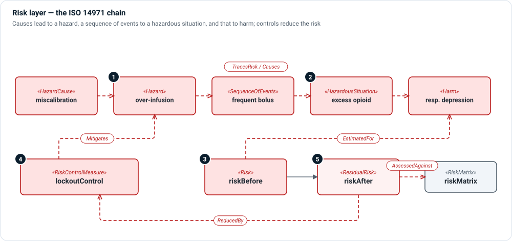

# Risk layer

**The question:** what could cause harm, how likely and how severe is it, and
what reduces it?

The risk layer models ISO 14971 as a chain you can follow, rather than a table
you fill in. Each link is a typed element, so Architect can show the chain,
count what is uncontrolled and check that every control is verified.



1. **The causal chain** — a `HazardCause` leads to a `Hazard`; a
   `SequenceOfEvents` turns the hazard into a `HazardousSituation`, which can
   lead to `Harm`. Link the steps with `TracesRisk` or, where the cause matters,
   `Causes` with a `causeKind`.
2. **Hazardous situation and harm** — the point where a person is exposed, and
   the injury or damage that may follow.
3. **Risk estimate** — a `Risk` is `EstimatedFor` a harm or situation, with
   probability and severity, and `AssessedAgainst` a `RiskMatrix`.
4. **Risk controls** — a `RiskControlMeasure` `Mitigates` a hazard (or a cause,
   or a situation), and requirements derive from it with `DerivesFrom`.
5. **Residual risk** — a `ResidualRisk` is `ReducedBy` the controls that apply.
   `OverallResidualRiskEvaluation` and `Benefit` (with `WeighedAgainst`) close the
   benefit–risk argument.

Analyses feed the chain: `FMEAWorksheet` with `FailureMode`, `FailureEffect`,
`FailureCause` and `DetectionMethod`; `FaultTree` with `FaultTreeNode` and
`MinimalCutSet`; `HAZOPStudy` with `HAZOPNode` and `HAZOPDeviation`.
`ReasonablyForeseeableMisuse` records misuse that ISO 14971 requires you to
consider.

## Kinds

| Kind | Use it for |
|---|---|
| `HazardCause`, `Hazard`, `SequenceOfEvents`, `HazardousSituation`, `Harm` | The ISO 14971 chain. |
| `Risk`, `ResidualRisk`, `RiskMatrix` | Estimation and evaluation. |
| `RiskControlMeasure` | A control: inherent safety, protective measure or information for safety. |
| `Benefit`, `OverallResidualRiskEvaluation` | Benefit–risk analysis. |
| `FMEAWorksheet`, `FailureMode`, `FaultTree`, `HAZOPStudy` … | Analyses that identify hazards and causes. |
| `ReasonablyForeseeableMisuse`, `SafetyRelatedCharacteristic` | Inputs ISO 14971 asks for. |

## Relationships

| Relationship | Meaning |
|---|---|
| `TracesRisk` | One risk element leads to the next in the chain. |
| `Causes` | A cause produces an effect; `causeKind` says how (for example, use error leads to hazard). |
| `LeadsToHarm` | A situation leads to a harm. |
| `EstimatedFor` | This risk is estimated for this harm or situation. |
| `AssessedAgainst` | This risk is assessed against this matrix. |
| `Mitigates` | This control mitigates this hazard, cause, situation or vulnerability. |
| `ReducedBy` | This residual risk is reduced by this control. |
| `HasFailureMode`, `DetectedBy`, `InputToGate`, `IdentifiesHazard` | FMEA, FTA and HAZOP links. |

## Example

```sysml
item overdoseHazard : Hazard {
    @MemoIdentity { :>> providedId = "HZ-001"; :>> label = "OpioidOverInfusion"; }
    attribute :>> hazardType = HazardTypeKind::drugDeliveryError;
    attribute :>> severity = SeverityKind::catastrophic;
}

connection : TracesRisk connect sourceRiskElement ::> causeFrequentBolus to targetRiskElement ::> overdoseHazard;
connection : TracesRisk connect sourceRiskElement ::> overdoseHazard to targetRiskElement ::> seqFrequentBolus;
connection : TracesRisk connect sourceRiskElement ::> hsExcessInfusion to targetRiskElement ::> harmRespiratoryDepression;
connection : EstimatedFor connect risk ::> riskBefore to riskElement ::> harmRespiratoryDepression;
connection : Mitigates connect control ::> lockoutControl to mitigatedElement ::> overdoseHazard {
    attribute :>> mitigationKind = MitigationKind::hazard;
}
```

## In Architect

- A **risk chain** diagram (`risk`) is a [general view](../views/general.md)
  laid out along the chain.
- An **FMEA** view (`fmea`) is a [grid view](../views/grid.md).
- **☰ › Model › Traceability Matrix** relates risk items to requirements and
  verification.
- **☰ › Model › Documents** generates the risk management file from this layer.

## Review checklist

- Does every hazard reach at least one harm, through a hazardous situation?
- Does every unacceptable risk have a control, and is every control verified?
- Are residual risks evaluated, and the overall residual risk weighed against
  benefit?
