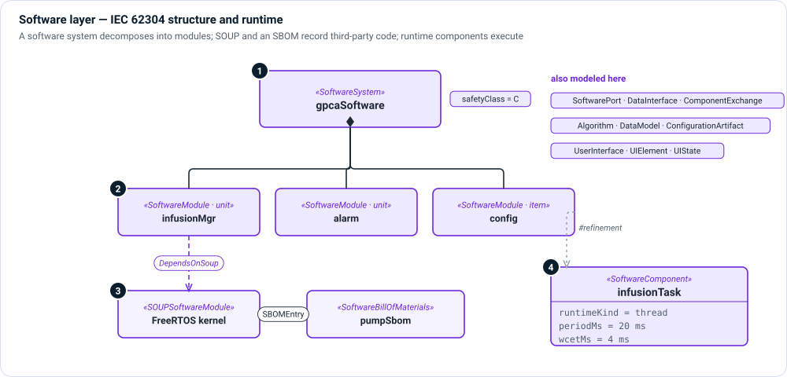

# Software layer

**The question:** which code realizes the design, how is it structured for
IEC 62304, and how does it run?

The software layer has two views of the same code. The **structural** view is
the IEC 62304 decomposition into software system, items and units, with
safety classes and third-party code. The **runtime** view is the set of
components that execute—tasks, processes, services—with their timing.



1. **Software system** — `SoftwareSystem`, the root of the IEC 62304
   decomposition, with its `safetyClass` (A, B or C).
2. **Software items and units** — `SoftwareModule` parts; `moduleKind` says
   whether a module is an item or a unit. Each has a responsibility, a safety
   class and ports.
3. **SOUP and SBOM** — `SOUPSoftwareModule` and `OTSSoftwareModule` record
   third-party code. `DependsOnSoup` says who depends on it, and a
   `SoftwareBillOfMaterials` holds `SBOMEntry` records for the cybersecurity
   layer to monitor.
4. **Runtime components** — `SoftwareComponent` (and `OTSSoftwareComponent`) with
   `runtimeKind` (thread, process, service, partition…), period, deadline, WCET,
   priority and restart policy. A `#refinement` dependency ties a runtime component
   to the module it runs.

The same layer holds data and configuration (`Algorithm`, `DataModel`,
`ConfigurationArtifact`, `DataItem`), software interfaces (`SoftwarePort`,
`SoftwareInterface`, `DataInterface`, `ComponentExchange`) and the user interface
(`UserInterface`, `UIElement`, `UIState`, `UIEvent`, `UIAction`, `InteractionFlow`).

!!! tip "Technology-specific runtime kinds"
    The base `SoftwareComponent` stays technology-neutral. For ROS 2 nodes, AADL
    threads and partitions, cloud services or message brokers, import an
    [extension](../extensions/index.md).

## Kinds

| Kind | Use it for |
|---|---|
| `SoftwareSystem` | The IEC 62304 software system. |
| `SoftwareModule` | A software item or unit (`moduleKind`). |
| `SOUPSoftwareModule`, `OTSSoftwareModule` | Third-party or off-the-shelf code. |
| `SoftwareBillOfMaterials`, `SBOMEntry` | The SBOM and its entries. |
| `SoftwareComponent`, `OTSSoftwareComponent` | Something that executes. |
| `SoftwarePort`, `SoftwareInterface`, `ComponentExchange` | Software interaction points and their connections. |
| `Algorithm`, `DataModel`, `ConfigurationArtifact` | Design content a review needs to see. |
| `UserInterface`, `UIElement`, `UIState`, `UIAction` | The user interface, screen by screen. |

## Relationships

| Relationship | Meaning |
|---|---|
| Part ownership (native) | This module is part of that item or system. |
| `DependsOnSoup` | This component depends on this SOUP item. |
| `interface` / `connect` (native) | These software ports are connected. |
| `satisfy` (native) | This module satisfies this software requirement. |
| `#refinement dependency` (native) | This runtime component refines this module. |
| `BuildsInto` | This module is built into that deployment unit (see [Deployment](deployment.md)). |

## Example

```sysml
part gpcaSoftware : SoftwareSystem {
    part infusionMgr : SoftwareModule {
        @MemoIdentity { :>> providedId = "SW-005"; :>> label = "Infusion_Manager"; }
        attribute :>> responsibility = "Handle drug infusion commands and therapy parameters.";
        attribute :>> safetyClass = SafetyClassKind::C;
        in port portImAlarmIn : SoftwarePort {
            attribute :>> portKind = InterfaceKind::notification;
        }
    }
}
```

## In Architect

- A **software architecture view** is either a [general view](../views/general.md)
  of the module tree or an [interconnection view](../views/interconnection.md)
  of runtime components and their ports.
- **☰ › Views › UI Screens** maps screenshots to `UIElement`s: detect regions,
  label them and accept them into the model.
- **☰ › Model › Documents** generates the IEC 62304 software documents from this
  layer.

## Review checklist

- Does every software item and unit have a safety class, and does it match the
  hazards it contributes to?
- Is every SOUP item listed with a version, a known-anomaly review and an SBOM
  entry?
- Are runtime timing properties stated where a requirement depends on them?
