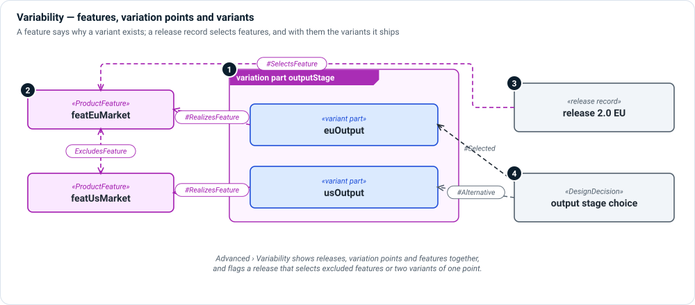

# Variability

**The question:** where does a product family differ, and why does each
difference exist?

Variability is not a layer of its own so much as a dimension through all of
them: a variant can be a logical component, a software module, a scenario or a
requirement. MEMO uses SysML's own variation points and adds the **feature** to
say why a variant exists.



1. **Variation point and variants** — a `variation` usage owns `variant`
   usages. A variant is an ordinary part, action or other element. The variation
   point owns nothing but its variants; put status and other attributes on the
   variants.
2. **Features** — a `ProductFeature` is something the family offers: a market,
   an accessory, a capability. A variant `#RealizesFeature` a feature.
   `RequiresFeature` and `ExcludesFeature` constrain which features can be chosen
   together.
3. **Release records** — a release record `#SelectsFeature` the features it
   ships, and through them the variants it contains.
4. **Design decisions** — a `DesignDecision` weighs variants (`#Alternative`) and
   names the one it chose (`#Selected`).

## Example

```sysml
part featEuMarket : ProductFeature;
part featUsMarket : ProductFeature;
connection : ExcludesFeature
    connect firstFeature ::> featEuMarket
    to secondFeature ::> featUsMarket;

variation part outputStage : LogicalComponent {
    variant part euOutput : LogicalComponent;
    variant part usOutput : LogicalComponent;
}
#RealizesFeature dependency from outputStage::euOutput to featEuMarket;
#RealizesFeature dependency from outputStage::usOutput to featUsMarket;
```

## In Architect

**☰ › Advanced › Variability** lists releases, variation points with their
variants, and features with what they require, exclude, are realized by and are
selected by. Ticking a feature on a release writes the `#SelectsFeature`
statement into the release's file. Problems with a selection show on the
release as soon as the model rebuilds. Operational flows show variants as rows
you can switch between. See [Features and Design Options](../../users/variability.md)
for the page itself.

## Review checklist

- Does every variant realize a feature, so its reason for existing is recorded?
- Does every release select a consistent set of features—nothing excluded,
  nothing required missing, one variant per variation point?
