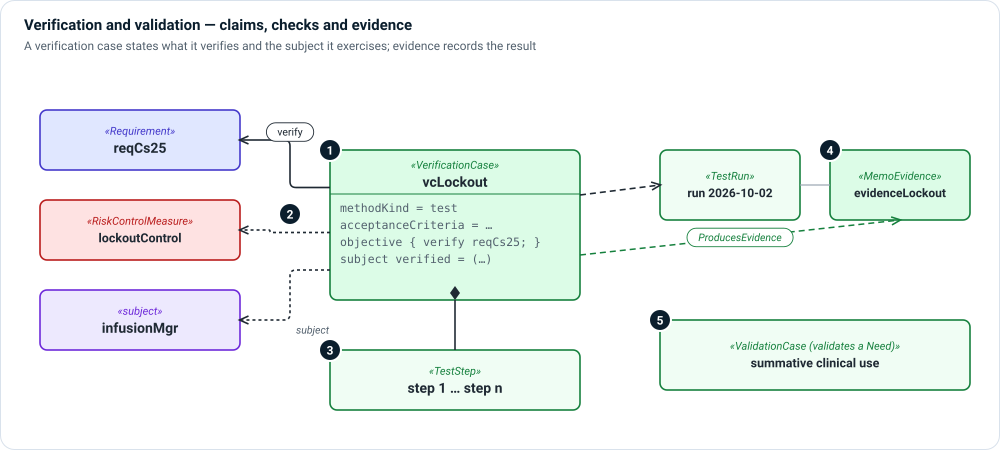

# Verification and validation layer

**The question:** how do we know each claim in the model holds?

Verification asks "did we build it right?"—does the design meet each
requirement and does each risk control work. Validation asks "did we build the
right thing?"—does the device meet user needs in its intended use. Both end in
evidence.



1. **Verification case** — a `VerificationCase` states its method (`inspection`,
   `analytical`, `demonstration`, `test`, `simulation`, `formalProof` or
   `modelChecking`),
   acceptance criteria and status.
2. **What it verifies, and on what** — the case's `objective` lists the requirements it
   `verify`s (including contracts and properties, which are requirements too),
   and its `subject` lists the elements it exercises—design elements and the risk
   controls whose effectiveness it shows. Both use SysML's own keywords.
3. **Steps** — `TestStep` actions, ordered, with expected results; `PerformsStep`
   links a run to the steps it performed.
4. **Evidence** — a case `ProducesEvidence` in a `MemoEvidence` record: a test
   report, a proof, an analysis. A `TestRun` records one execution with its
   `MeasuredValue`s.
5. **Validation** — a `ValidationCase` `Validates` a need or the intended use;
   usability and clinical evaluation (`ClinicalEvaluation`) are validation too.

## Kinds

| Kind | Use it for |
|---|---|
| `VerificationCase` | A check of a requirement, control or property. |
| `ValidationCase` | A check that a need or the intended use is met. |
| `SecurityAssessmentCase` | A verification case for security. |
| `TestStep`, `TestRun`, `MeasuredValue` | How a case is carried out and what it measured. |
| `MemoEvidence` | The record a case produced. |
| `ClinicalEvaluation`, `PostMarketSurveillance` | Clinical evidence and feedback after release. |

## Relationships

| Relationship | Meaning |
|---|---|
| `verify` inside `objective` (native) | This case verifies this requirement. |
| `subject` (native) | This case exercises these elements, such as a risk control. |
| `ProducesEvidence` | This case produced this evidence. |
| `Validates` | This validation case validates this need. |
| `PerformsStep` | This run performed this step. |
| `FeedsBackTo` | Post-market data feeds back to this element. |

## Example

```sysml
verification vcLockout : VerificationCase {
    @MemoIdentity { :>> providedId = "VER-002"; :>> label = "VerifyBolusLockout"; }
    attribute :>> methodKind = MemoVerificationMethodKind::test;
    attribute :>> acceptanceCriteria = "No patient bolus initiated when lockout or max bolus constraints active";
    attribute :>> status = ElementStatusKind::approved;

    objective { verify reqCs25; verify guaranteeLockoutPreventsBolus; }
    subject verified : Base::Anything[*] = (lockoutControl, gpcaSoftware.infusionMgr, fnEnforceLimits);
}

connection : ProducesEvidence
    connect producer ::> vcLockout
    to producedEvidence ::> evidenceLockout;
```

## In Architect

- A **verification coverage** view shows which requirements and controls have
  cases and evidence. See [Grid views](../views/grid.md).
- **☰ › Model › Traceability Matrix** relates requirements, controls and cases;
  the gap filter lists what has no verification.
- The **Problems** bar reports closure rules such as "every safety requirement
  has a verification case". See [Validation and Closure](../../users/validation.md).

## Review checklist

- Does every requirement and every risk control have at least one case that
  verifies it?
- Does every approved case have evidence, and does the evidence match the
  acceptance criteria?
- Is each user need validated, not only verified?
