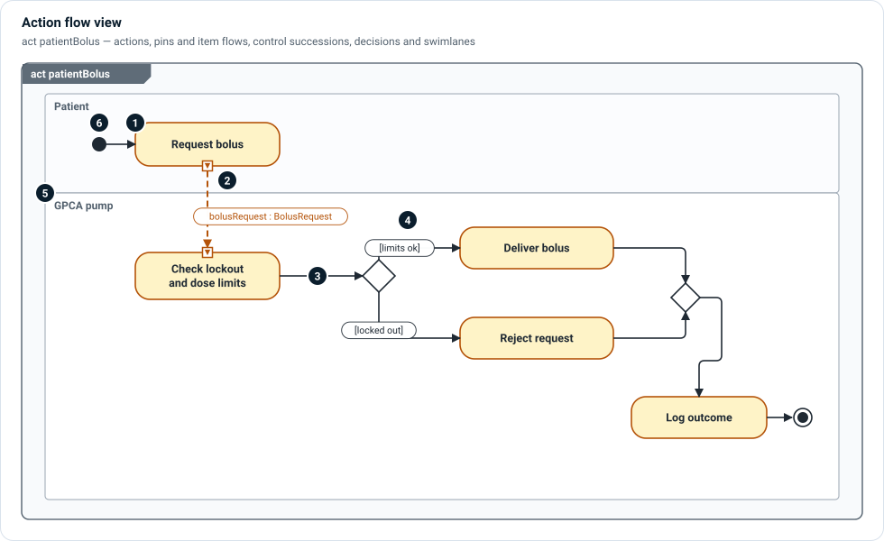

# Action flow views

An action flow view shows **behavior as a flow of actions**: what happens, in
what order, what each step consumes and produces, and who or what performs it.

| `diagramType` | Diagram | Typical content |
|---|---|---|
| `ofd` | Operational flow | Operative actions of a scenario, by role |
| `ffd` | Function flow | System functions and the items they exchange |
| `afd`, `act` | Activity / action flow | Any action with its sub-actions |

These are separate authored views of a scenario, not display modes of one
diagram: an operational flow and the function flow that supports it are two
views you can compare side by side.



1. **Actions** — rounded rectangles: an `OperativeAction`, a `SystemFunction`,
   or any action usage. A long name wraps.
2. **Pins and item flows** — small squares on an action are its parameters
   (`in` and `out`). A dashed arrow from an `out` pin to an `in` pin is an
   **item flow**, labelled with the item that travels (`bolusRequest :
   BolusRequest`). Pins appear when an action usage is typed.
3. **Control flow** — solid arrows are successions: this action starts after
   that one ends.
4. **Decisions and merges** — a diamond splits the flow on guards in square
   brackets (`[limits ok]`, `[locked out]`) and joins it again. A thick bar forks
   or joins parallel branches.
5. **Swimlanes** — horizontal lanes show who performs each action: an actor, a
   component, a role. In SysML terms an action in a lane is performed by, or
   allocated to, that lane's part.
6. **Start and end** — a filled circle starts the flow; a ringed circle ends it.

## In SysML

```sysml
item def BolusRequest;

action patientBolus {
    action requestBolus { out bolusRequest : BolusRequest; }
    action checkLimits  { in  bolusRequest : BolusRequest; }
    action deliverBolus;
    action rejectRequest;
    action logOutcome;
    attribute limitsOk : ScalarValues::Boolean;

    flow from requestBolus.bolusRequest to checkLimits.bolusRequest;

    first start then requestBolus;
    first requestBolus then checkLimits;
    first checkLimits then limitDecision;
    decide limitDecision;
        if limitsOk then deliverBolus;
        else rejectRequest;
    first deliverBolus then logOutcome;
    first rejectRequest then logOutcome;
}
```

## In Architect

- Composite actions can be **folded** or opened with **drill-down**, and steps
  shown **inline** or **nested**, without changing the model.
- Variants of a flow show as rows on one flow, with chips to switch between and
  preview them (see [Variability](../layers/variability.md)).
- Dragging from one pin to another sends the parameter names, so you can author
  an item flow on the canvas.

## Related

- [Operational layer](../layers/operational.md) — scenarios and operative actions.
- [Functional layer](../layers/functional.md) — functions, exchanges and allocation.
- [Clinical and anatomy extensions](../extensions/clinical-anatomy.md) — procedure
  steps in swimlanes per role.
