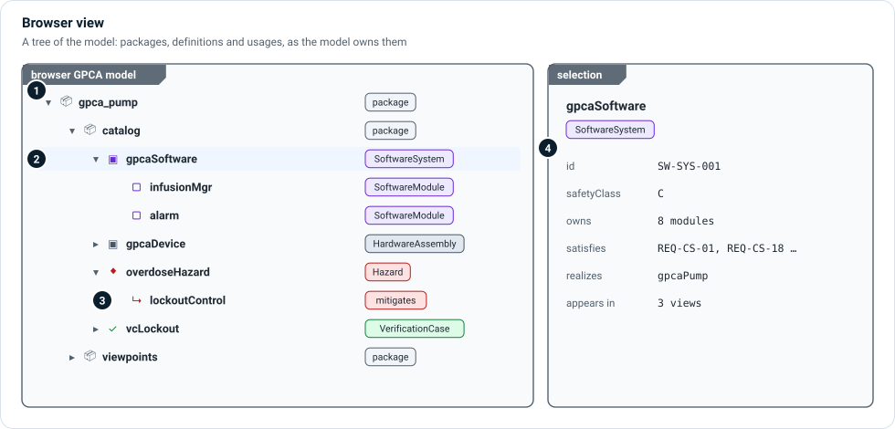

# Browser views

A browser view shows the model as a **tree**: packages containing definitions,
definitions containing usages, the way the model owns them. It is the view to
use when you need to find something, see what a package holds, or check the
decomposition of a system without drawing it.

1. **Packages** — folders that hold model content. Packages are for ownership
   and review; they do not decide an element's meaning.
2. **Definitions and usages** — each row is an element, nested under its owner.
   Select one to open it.
3. **Kinds** — the chip on each row is the element's MEMO kind. Relationships an
   element owns (a `Mitigates` connection, for example) appear under it.
4. **Selection** — the Properties panel shows the selected element's id,
   attributes, relationships and the views it appears in.

## In Architect

The **Model Explorer** is the browser view you use most:

- It groups elements **by kind first**, then by package if you switch on
  **Show packages as folders** (Settings, or the switch beside the collapse
  button). Requirements are grouped by requirement type, and use cases by
  declared level.
- **Filter element types** and **Filter systems** narrow the tree; both are
  searchable lists with counts.
- Folder counts show how many elements each folder holds.

Document views—the DHF documents in **☰ › Model › Documents**—are also browser
views: a tree of sections drawn from the model.

## Related

- [Layers](../layers/index.md) — how the explorer's kind folders map to layers.
- [Workbench UI](../../users/ui-usage.md) — the explorer, Properties panel and
  navigation.
