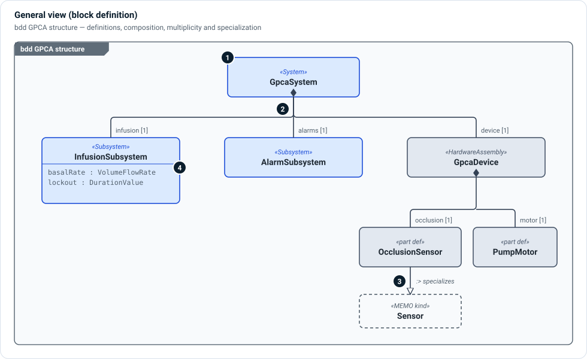

# General views

A general view shows **elements and the relationships between them**, without
the port-and-connector detail of an interconnection view or the ordering of a
behavior view. It is the SysML v2 view kind behind several familiar diagrams:

| `diagramType` | Diagram | Typical content |
|---|---|---|
| `bdd` | Block definition diagram | Definitions, composition, specialization |
| `pkg` | Package diagram | Packages and their imports |
| `req` | Requirements diagram | Needs, requirements and their derivation |
| `ucd` | Use case diagram | See [Use case and context views](use-case-and-context.md) |
| `context` | System context | See [Use case and context views](use-case-and-context.md) |
| `risk` | Risk chain | Causes, hazards, situations, harms and controls |
| `threat-model` | Threat model | Assets, threats, vulnerabilities, mitigations |

## Block definition diagram



1. **Blocks** are definitions (or usages): the «stereotype» is the MEMO kind,
   the bold name is the element.
2. **Composition** — a line with a filled diamond at the owner means "is made
   of". The role name and multiplicity (`infusion [1]`) sit at the part end. In
   SysML this is a part usage inside the owner's definition.
3. **Specialization** — a hollow triangle points to the more general definition
   (`:>` in SysML). Here a project's `OcclusionSensor` specializes MEMO's
   `Sensor` kind, so it inherits every attribute and rule of a sensor.
4. **Compartments** list attributes and their types, when the review needs them.

A BDD shows **what things are and what they are made of**. It deliberately says
nothing about signal direction; draw an [interconnection view](interconnection.md)
for that.

## Relationship graphs

Requirements, risk-chain and threat-model diagrams use the same general view to
show typed relationships as labelled dashed arrows: `DerivesFrom` between needs
and requirements, `TracesRisk` and `Mitigates` along a risk chain, `Exploits`
and `ThreatenedBy` in a threat model. The figures on the
[Requirements](../layers/requirements.md), [Risk](../layers/risk.md) and
[Cybersecurity](../layers/cybersecurity.md) pages are drawn this way.

## In Architect

- The general view has a **level** dropdown and one **Expand / Collapse all**
  toggle. Tree and containment modes lay a decomposition out top-down or nested.
- Architect warns when a block diagram mixes element kinds that do not belong
  together, which usually means a view's selection is too wide.
- A view selects what it shows with `expose` and a selection query (element
  kinds and layers to include). Views can also select declared relationship
  types such as `verifiedBy`, `derivesFrom` and `realizes`.

```sysml
view logicalArchitectureView : MemoDiagramView {
    @MemoIdentity { :>> providedId = "VIEW-LOG-001"; :>> label = "LogicalArchitectureView"; }
    attribute :>> diagramType = "bdd";
    ref :>> viewpointDefinition = logicalViewpoint;
    expose memo_examples_gpca_pump_gpca_architecture::gpcaPump::**;
}
```
