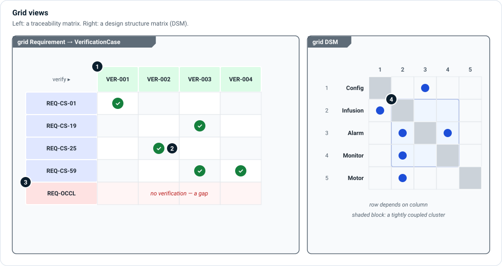

# Grid views

A grid view shows the model as **rows and columns**. Grids answer coverage and
dependency questions that a diagram cannot: "is every requirement verified?",
"which components depend on each other?", "what does each failure mode cause?".

| Grid | Where | Typical question |
|---|---|---|
| Traceability matrix | **☰ › Model › Traceability Matrix** | Is every requirement satisfied and verified? |
| Design structure matrix (DSM) | **☰ › Advanced › Design Structure Matrix** | Which components are tightly coupled? |
| FMEA (`diagramType = "fmea"`) | A view in the risk viewpoint | What does each failure mode cause, and how is it detected? |
| Allocation (`diagramType = "alloc"`) | A view in the functional or software viewpoint | Which element owns each function? What deploys where? |
| Tables | Any element collection | Attributes of many elements at once |

## Traceability matrix

1. **Rows and columns** are two sets of elements you choose: by kind, by
   package, by a saved query, or by a quick trace (`Requirement → VerificationCase`).
2. **A filled cell** is a relationship between the row and the column: here,
   the verification case verifies the requirement. Click it to inspect the
   relationship, or remove one that has a recorded source.
3. **An empty row** is a gap: a requirement no case verifies. The gap filter
   lists only those rows.

A matrix can be shown as a table or a list, filtered, and **saved as a view** in
a package, so the same coverage question can be asked at every review. Matrices
can be tied to one system or system of systems.

## Design structure matrix

4. **A DSM** lists the same elements on both axes. A mark means the row element
   depends on the column element. Reordering rows groups tightly coupled elements
   into **clusters** along the diagonal—candidates for one subsystem, or for an
   interface to simplify.

Named groups and critical elements can be highlighted on the axis and in the
inspector. A DSM exports to a spreadsheet.

## Related

- [Requirements layer](../layers/requirements.md) and
  [Verification and validation](../layers/verification.md) — what a traceability
  matrix relates.
- [Risk layer](../layers/risk.md) — what an FMEA grid shows.
- [Analysis Tools](../../users/analysis-tools.md) — the matrices in more depth.
