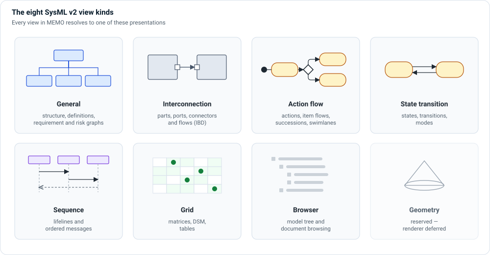

# Views and diagrams

A **view** shows a selected part of the model for one review question. It does
not copy the model: an element you change once appears changed in every view
that shows it. Each view conforms to a **viewpoint**, which states the concern,
the audience and what the view may contain (ISO/IEC/IEEE 42010).

Every view resolves to one of the eight SysML v2 **view kinds**. A view's
`diagramType` picks a familiar diagram within its kind:

| View kind | Diagram types | Shows | Page |
|---|---|---|---|
| General | `bdd`, `pkg`, `req`, `ucd`, `context`, `risk`, `threat-model` | Definitions, structure and relationship graphs | [General](general.md), [Use case and context](use-case-and-context.md) |
| Interconnection | `ibd`, `par` | Parts, ports, connectors and the flows over them | [Interconnection](interconnection.md) |
| Action flow | `act`, `afd`, `ofd`, `ffd` | Actions, item flows, control flow, swimlanes | [Action flow](action-flow.md) |
| State transition | `stm` | States, transitions, modes | [State transition](state-transition.md) |
| Sequence | `seq` | Lifelines exchanging ordered messages | [Sequence](sequence.md) |
| Grid | `fmea`, `alloc`, matrices, DSM | Tables and matrices | [Grid](grid.md) |
| Browser | — | The model tree and document views | [Browser](browser.md) |
| Geometry | — | Reserved; Architect does not draw geometry yet | — |

## Which view for which question

| Review question | Use |
|---|---|
| What is outside the device boundary? | [Context view](use-case-and-context.md#context-view) |
| What do users want to achieve? | [Use case view](use-case-and-context.md#use-case-view) |
| What is the device made of? | [General view (BDD)](general.md) |
| What is connected to what, and what flows? | [Interconnection view (IBD)](interconnection.md) |
| What happens, in what order, and who does it? | [Action flow view](action-flow.md) |
| Which mode is the device in, and what changes it? | [State transition view](state-transition.md) |
| Who sends what to whom, when? | [Sequence view](sequence.md) |
| Is every requirement verified? Which components depend on each other? | [Grid views](grid.md) |
| Where is this element in the model? | [Browser view](browser.md) |

## Viewpoints by layer

The ontology ships a viewpoint for each layer, with ready-made views:

| Viewpoint | Typical views |
|---|---|
| Context | System context |
| Operational, clinical workflow | Use case diagram, operational flows |
| Requirements | Requirements traceability |
| Functional | Functional tree, function allocation, function flows |
| Logical | Logical architecture (BDD and IBD) |
| Software | Software architecture |
| Physical | Physical bill of materials, network topology |
| Risk | Risk chain, FMEA |
| Cybersecurity | Threat model, cybersecurity assessment |
| Usability | Usability engineering, screen layout |
| Verification | Verification coverage |

## Open and author views

- **☰ › Views › Viewpoints** lists every viewpoint and its views. The **Role**
  control in the top bar narrows the list to the viewpoints written for your
  role.
- Each view lives in SysML source, so it is reviewed and versioned with the
  model. Its layout (positions, sizes, connector routes) is saved inside the
  view's own source too.
- See [Viewpoints and Diagrams](../../users/viewpoints-diagrams.md) for how to add a
  view, bind it to a viewpoint, edit layouts and export.

!!! note "About the figures"
    The figures on these pages are illustrations, numbered so the text can refer
    to each part. Architect's own rendering of the same content uses the same
    notation with more detail.
