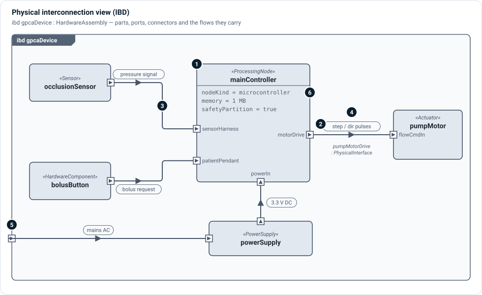
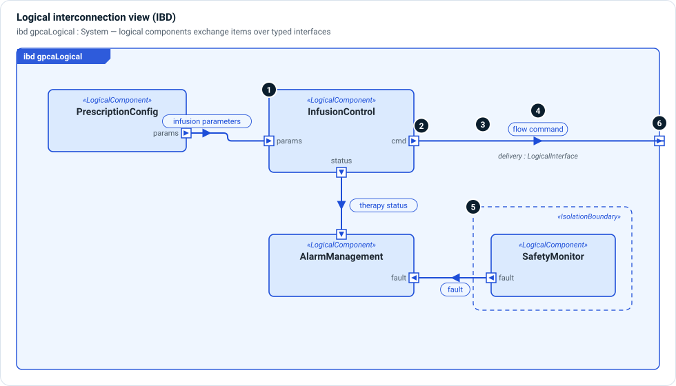

# Interconnection views (IBD)

An interconnection view—an **internal block diagram**, or IBD—shows the inside
of one part: the parts it contains, the **ports** on their boundaries, the
**connectors** that join ports, and the **items that flow** over those
connectors. Use it to answer "what is connected to what, through which
interface, and what passes between them?"

The same notation serves every layer. A **physical IBD** shows hardware wired
together; a **logical IBD** shows responsibilities exchanging information; a
**software IBD** shows runtime components and their software ports. In SysML v2
terms the view kind is *interconnection*; set `diagramType = "ibd"`.

## Physical interconnection



Read the figure from the outside in:

1. **Parts** — each rectangle is a part *usage* inside the enclosing part
   (`gpcaDevice`). The «stereotype» is its kind: `ProcessingNode`, `Sensor`,
   `Actuator`, `PowerSupply`. Parts can nest; dragging a part in Architect moves
   everything inside it.
2. **Ports** — the small squares on a part's edge are its `PhysicalPort`s: the
   only places it can be connected. The arrow inside a port shows **direction**:
   pointing in for `in`, out for `out`, a bar for `inout`. A port has a name, a
   kind (power, digital signal, analog signal, API) and a connector type.
3. **Connectors** — a line between two ports is a **connector**. In MEMO it is
   usually an `interface` usage typed by a `PhysicalInterface`, which records the
   medium, signaling, protocol, voltage and current of that connection. A port
   can have several connectors; a connector always joins exactly two ports.
4. **Flows** — the filled arrowhead and label on a connector is an **item flow**:
   what actually travels, and in which direction. A pressure signal, a bolus
   request, step pulses, 3.3 V DC. The flow's direction must agree with the
   ports it runs between: out of an `out` port, into an `in` port.
5. **Boundary ports** — a port on the frame belongs to the enclosing part. A
   connector from a boundary port to an inner part is a **delegation**: mains
   power enters the device and is handed to the power supply.
6. **Compartments** — a part can show selected attributes (node kind, memory,
   safety partitioning) so the diagram answers a review question without opening
   the Properties panel.

In SysML source, the same picture is:

```sysml
item def StepPulses;

part gpcaDevice : HardwareAssembly {
    part mainController : ProcessingNode {
        in  port sensorHarness : PhysicalPort;
        out port motorDrive    : PhysicalPort;
    }
    part pumpMotor : Actuator {
        in port flowCommandIn : PhysicalPort;
    }

    // connector, typed by an interface definition
    interface pumpMotorDrive : PhysicalInterface
        connect mainController.motorDrive to pumpMotor.flowCommandIn {
        attribute :>> signalingKind = SignalingKind::pulse;
    }

    // what travels over it
    flow of StepPulses from mainController.motorDrive to pumpMotor.flowCommandIn;
}
```

## Logical interconnection



A logical IBD uses the same symbols for implementation-neutral parts:

1. **Logical components** own responsibilities rather than hardware.
2. **Logical ports** (`LogicalPort`, or the more specific `DataPort`,
   `CommandPort`, `SensorPort`) show direction as in the physical view.
3. **Connectors** are typed by a `LogicalInterface` (or a `ComponentExchange`).
   Where you only need to state that one component commands, feeds or powers
   another, a `LogicalConnector` connection with a `contentKind` is enough.
4. **Exchange items** (`LogicalExchangeItem`, `InterfaceItem`) flow over the
   connectors: infusion parameters, a flow command, therapy status, a fault.
5. **Isolation boundaries** are drawn as dashed regions around the parts they
   contain. A connector that crosses one is a place to check independence.
6. **Boundary ports** carry exchanges to and from the rest of the system.

## Rules that keep an IBD honest

- **Connect ports, not parts.** A connector that ends on a part body hides which
  interface it uses. Add the port.
- **Match directions.** An `out` port feeds an `in` port; two `out` ports on one
  connector is a modeling error, and the flow arrow will show it.
- **Name what flows.** A connector without an item flow says that two things are
  connected, not what they exchange. Reviewers need the item, with units where
  it is physical.
- **Type the connector.** A `PhysicalInterface` or `LogicalInterface` gives the
  connection attributes that a requirement can constrain and a test can check.
- **One level at a time.** Show the parts of one enclosing part. Open a nested
  part's own IBD rather than expanding everything.

## Working with IBDs in Architect

- Drag a part by its title to move it; its ports, nested parts and connectors
  move with it. Drag a port to slide it along the part's edge; ports never
  overlap.
- Connectors are routed at right angles by default. **Routing type** on the
  toolbar changes the style for the diagram or for selected connectors;
  **Auto-route** reroutes them.
- **Part spacing** and **Port spacing** open up a crowded automatic layout.
  Every automatic change is one Undo step.
- The layout is saved inside the view's own source, so it travels with the
  model.

`examples/vehicle-ibd` in the Architect repository is a dense IBD to practice on:
run `pnpm example:vehicle`. More editing details are in
[Viewpoints and Diagrams](../../users/viewpoints-diagrams.md#editing-an-internal-block-diagram).

## Related

- [Hardware and physical layer](../layers/hardware-physical.md) — the kinds a
  physical IBD shows.
- [Logical layer](../layers/logical.md) — the kinds a logical IBD shows.
- [ROS 2 extension](../extensions/ros.md) — nodes, publisher and subscriber
  ports, and topics in an IBD.
- **☰ › Views › Interfaces** — every interface between two chosen parts, as a
  list you can save as a page.
