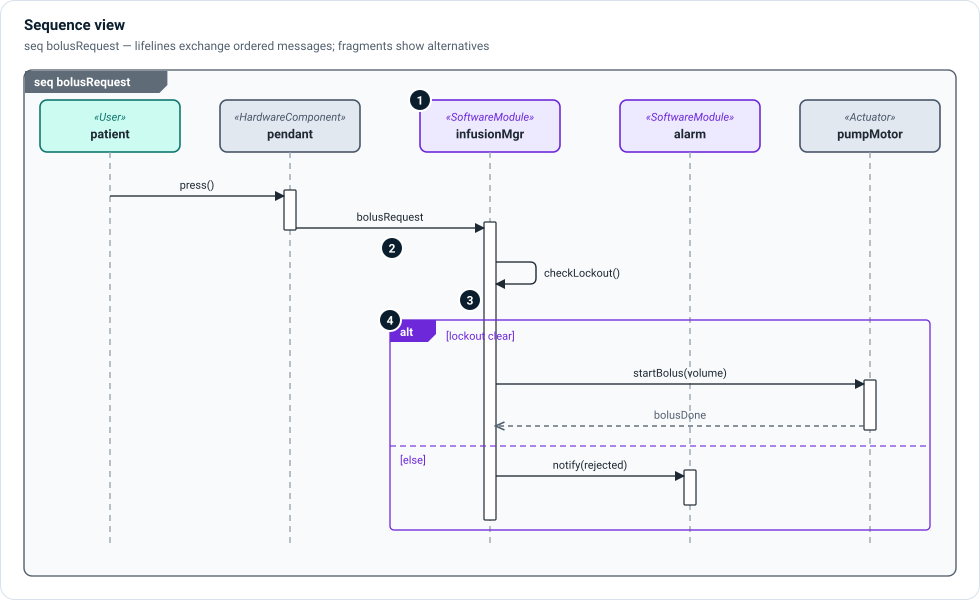

# Sequence views

A sequence view (`diagramType = "seq"`) shows **who sends what to whom, in
what order**. Time runs down the page. Use it for an interaction across several
parts: a bolus request travelling from the patient's button to the motor, a
service call, a ROS action's goal and feedback.



1. **Lifelines** — each participant (a user, a hardware component, a software
   module) has a header and a dashed line down the page. A lifeline is a part
   usage, so the participants are the same elements other views show.
2. **Messages** — a solid arrow with a filled head is a message or call, labelled
   with what is sent (`bolusRequest`, `startBolus(volume)`). A dashed arrow with
   an open head is a reply. A message that loops back to its own lifeline is a
   call to itself (`checkLockout()`).
3. **Activations** — the narrow bar on a lifeline shows when that participant
   is busy handling a message.
4. **Combined fragments** — a labelled frame groups messages: `alt` for
   alternatives with guards (`[lockout clear]`, `[else]`), `opt` for an optional
   part, `loop` for repetition, `par` for parallel branches.

## In SysML

```sysml
item def Press; item def BolusRequest; item def StartBolus;

occurrence def BolusRequestSequence {
    part patient;
    part pendant;
    part infusionMgr;
    part pumpMotor;

    message press of Press from patient to pendant;
    message request of BolusRequest from pendant to infusionMgr;
    message start of StartBolus from infusionMgr to pumpMotor;

    first press then request;
    first request then start;
}
```

## Related

- [Action flow views](action-flow.md) — the same scenario as a flow of actions.
- [State transition views](state-transition.md) — how the messages change modes.
- [ROS 2 extension](../extensions/ros.md) — services and actions as message
  exchanges.
