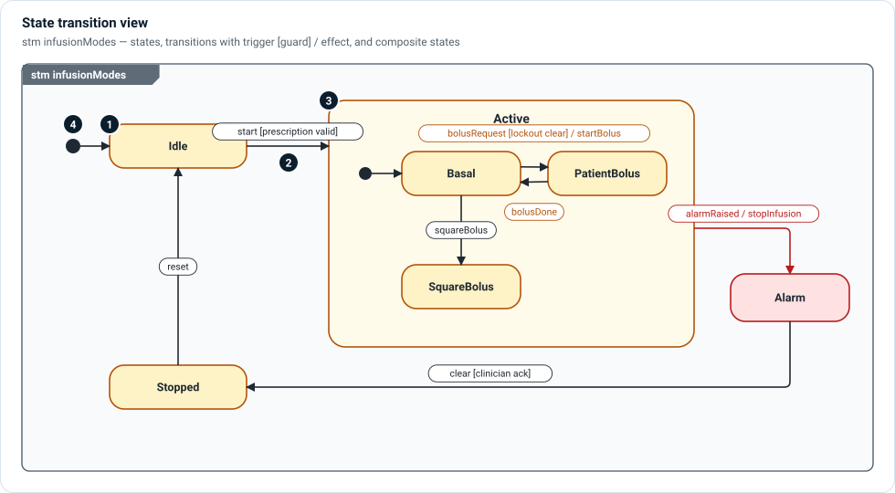

# State transition views

A state transition view (`diagramType = "stm"`) shows the **modes** a part can
be in and **what makes it change** from one to another. Use it for therapy
modes, alarm handling, startup and shutdown, and any behavior where the same
input means different things depending on the current state.



1. **States** — rounded rectangles. A state can have entry, do and exit actions.
   In MEMO a state machine is a `StateMachine` (or any state definition), and
   `ModeConfiguration` records what is enabled in each mode.
2. **Transitions** — arrows labelled `trigger [guard] / effect`:
   *bolusRequest* is the event, *[lockout clear]* the condition that must hold,
   *startBolus* the action taken. Each part is optional.
3. **Composite states** — a state can contain its own states. `Active` contains
   `Basal`, `PatientBolus` and `SquareBolus`; a transition out of `Active`
   (an alarm) leaves whichever inner state was current.
4. **Initial states** — a filled circle marks where a state machine, or a
   composite state, starts.

## In SysML

```sysml
item def BolusRequest; item def BolusDone; item def Start;
item def AlarmRaised; item def Clear;

state def InfusionModes :> StateMachine {
    attribute lockoutClear : ScalarValues::Boolean;
    attribute prescriptionValid : ScalarValues::Boolean;
    attribute clinicianAck : ScalarValues::Boolean;

    entry; then Idle;
    state Idle;
    state Active {
        entry; then Basal;
        state Basal;
        state PatientBolus;
        transition Basal_to_Bolus first Basal
            accept BolusRequest if lockoutClear do action startBolus then PatientBolus;
        transition first PatientBolus accept BolusDone then Basal;
    }
    state Alarm;
    state Stopped;
    transition first Idle accept Start if prescriptionValid then Active;
    transition first Active accept AlarmRaised do action stopInfusion then Alarm;
    transition first Alarm accept Clear if clinicianAck then Stopped;
}
```

MEMO's `@TransitionRecord` metadata can carry a requirement reference on a
transition, so a reviewer can see which requirement each guard implements.

## In Architect

Composite states can be **folded** and opened with **drill-down** without
changing the model, so a large mode machine can be reviewed one level at a time.

## Related

- [Functional layer](../layers/functional.md) — state machines, modes and contracts.
- [Sequence views](sequence.md) — the message exchange that drives a transition.
