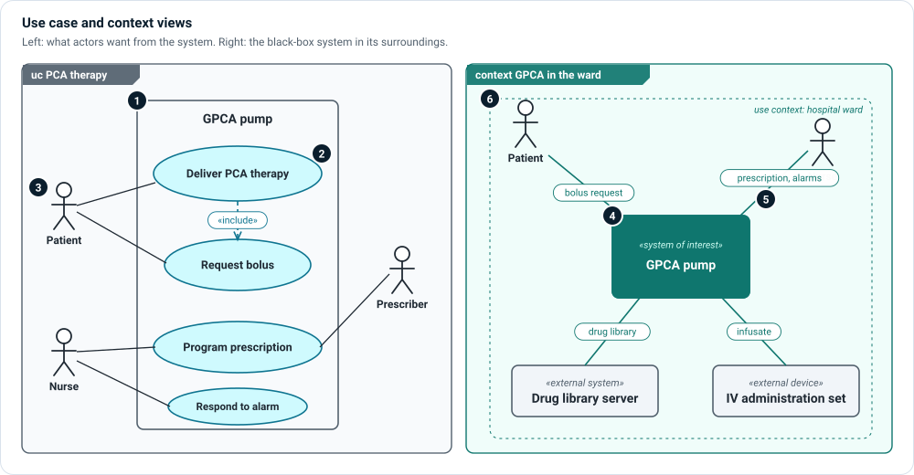

# Use case and context views

Two general views describe the device from outside. A **use case view** shows
what actors want to achieve with it; a **context view** shows the device as a
black box in its surroundings, with what it exchanges.

## Use case view

Set `diagramType = "ucd"`.

1. **System boundary** — the rectangle is the subject of the use cases, usually
   the system of interest. Use cases sit inside it; actors stand outside.
2. **Use cases** — each ellipse is a `ClinicalUseCase` or `SystemUseCase`: a
   goal, named from the actor's point of view. A dashed «include» arrow means one
   use case always includes another; «extend» means it sometimes does.
3. **Actors** — stick figures are `User`s (or other participants). A line from
   an actor to a use case means the actor takes part in it.

A use case view is a map of goals, not a description of behavior. Each use case
is realized by workflows and scenarios in the
[operational layer](../layers/operational.md), and drawn as an
[action flow](action-flow.md).

## Context view

Set `diagramType = "context"` and the view's `subjectElement` to the system of
interest.

4. **System of interest** — drawn as a single filled box. Its inside is
   deliberately hidden.
5. **Context exchanges** — each spoke to an actor or external system is labelled
   with what crosses the boundary: a bolus request, a prescription, a drug
   library, infusate. Every spoke becomes an interface someone must design.
6. **Use context** — the dashed region names where this picture applies (a
   hospital ward). A device used in several contexts gets one context view per
   context.

Architect lays out a context view with the system in the middle and spokes
bent around each other; spokes keep the bends you give them.

## Related

- [Context layer](../layers/context.md) — users, use contexts and intended use.
- [Operational layer](../layers/operational.md) — use cases, workflows and scenarios.
- **☰ › Views › Use Cases** — every use case with its workflows and scenarios.
