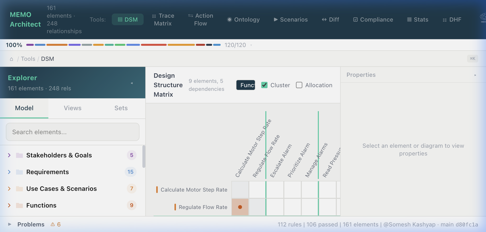
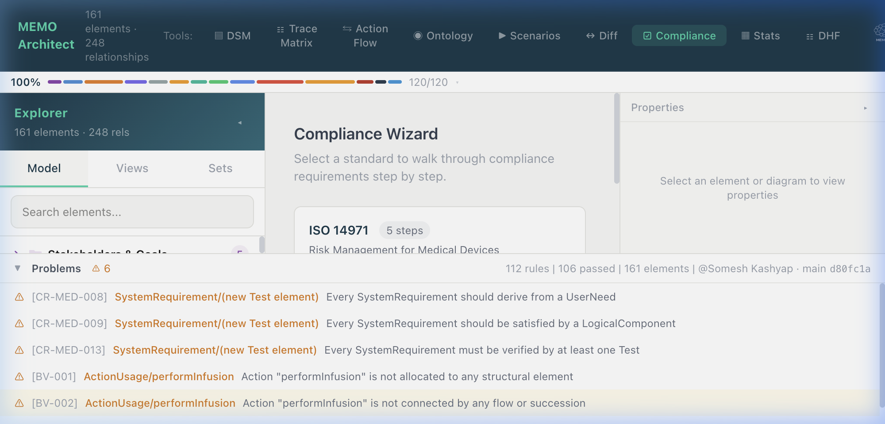

# Analysis Tools

Architect includes analysis tools for coverage, dependency management and risk analysis. Open the navigation (☰): the Traceability Matrix is under **Model**, and the Design Structure Matrix, Analysis Notebooks and Suspect Links are under **Advanced**. For what each grid shows, see [Grid views](../modeling/views/grid.md).

## Jupyter notebooks

**☰ › Advanced › Analysis Notebooks** opens the project's live JupyterLab workspace. Architect
starts JupyterLab itself the first time you open the view (see
[Jupyter starts for you](#jupyter-starts-for-you)). New projects created with `memo-architect init` contain an
`analysis/Samples` folder with seven sample notebooks:

- model overview and semantic composition;
- architecture hotspots and ownership depth;
- model-quality diagnostics;
- change-impact exploration;
- bar and diagnostic donut charts;
- an SVG ownership network graph;
- an HTML inventory table with CSV export.

The samples use standard SysML v2 types and read the model through
`analysis/memo_model.py`, which compiles the project with its compiler
(`toolchain.compiler`: the project's, or your own default where the project names none), as every MEMO
command does: change it and the notebooks follow.

### Jupyter starts for you

When you open the view under `memo-architect dev` (or `--example`), Architect starts
JupyterLab for the project, serving its `analysis` folder, and connects the view to it.
There is nothing to run.

- **Port and token.** The port is a free one picked at start, bound to `127.0.0.1` only. A
  random token protects the server, so other local users cannot use it; it is passed to
  Jupyter in its environment (not on the command line), and the page's
  **Open live JupyterLab** link carries it.
- **It stops with Architect.** When `memo-architect dev` exits (Ctrl-C, SIGTERM, or the
  browser closing) the JupyterLab it started is stopped, kernels included. A JupyterLab
  you started yourself, serving the same `analysis` folder, is reused and never stopped.
- **Not installed.** If JupyterLab cannot be found the view says so and how to install it
  (`pip install jupyterlab`). Architect looks for `jupyter` on `PATH`; set
  `MEMO_JUPYTER_BIN` to the executable when it is installed somewhere else (for example
  `pip install --user` on macOS puts it in `~/Library/Python/<version>/bin`).
- **Static viewers.** A viewer made with `memo-architect build` has no Architect process
  to run Jupyter, so it connects to a JupyterLab you started on `http://127.0.0.1:8888`:
  `cd analysis && jupyter lab --port 8888`.

To run only JupyterLab, without the workbench:

```bash
cd my-device
memo-architect jupyter
```

It prints the URL (with the token), stays in the foreground, and stops JupyterLab on
Ctrl-C. `-p, --port <port>` fixes the port. If a JupyterLab is already serving the
project's `analysis` folder it prints that one and exits, leaving it running.

The `memo` command must be on `PATH` there (or `MEMO_CLI` set to the command
that runs it), with whatever the selected compiler needs: `memo compile --probe`
reports it. MEMO's internal compiler builds no SysML v2 model, so it cannot
serve the notebooks; `memo_model.load()` says so.

## 1. Design Structure Matrix (DSM)

The DSM shows dependencies between elements as a matrix whose axes are the
model's own containment hierarchy: every row and column is a subsystem that
expands into its parts and collapses back into one line carrying their sum.


*Design Structure Matrix showing functional dependency clusters.*

### How it works

- **Nested axes.** Rows and columns are trees, not flat lists. `+`/`−` expands
  and collapses a subsystem; **Expand all**, **Collapse all** and **L1/L2/L3**
  move both axes at once. With **Linked axes** on, expanding a subsystem on one
  axis expands the same one on the other.
- **Numbered columns.** Columns are identified by number, the way Lattix does
  it — hover a column, or turn on **Column names**, to read its name.
- **Roll-up.** A cell between two collapsed lines carries the count of every
  dependency crossing between their subtrees. The identity diagonal shows the
  subsystem's share of the model's elements.
- **Subsystem boundaries.** A rule is drawn where a subsystem starts, heavier
  for shallower nesting, so block structure is visible without lines running
  the height of the page.

### One semantic type per axis

An axis holds **one** thing, and the picker enforces it. A row list that
interleaved a hazard, a requirement, a function and a test case would be a list
of unrelated objects, and the marks between such rows and columns could not be
read as a structure at all — so the choice is one architecture layer, or one
element type inside it, never a hand-assembled mixture.

A *layer* is the ontology's own unit of semantic kinship, which is why it is
the unit here: `System`, `Subsystem` and `LogicalComponent` are three kinds but
one logical architecture, and they belong on an axis together. Picking the
`Logical` layer gives you that whole tree; picking `LogicalComponent` inside it
narrows to the leaves.

Both matrices **open empty**: nothing is computed until you choose the axes.
The left panel lists the matrices already saved in the model, by package, so a
review can reopen the same matrix every time.

### What you choose

| Control | What it decides |
| --- | --- |
| **Rows** / **Columns** | What that axis holds: **one** architecture layer, or one element type within it. The two axes need not match — functions down the side and logical blocks across the top is a normal configuration. |
| **of** (next to each axis) | Which *individual elements* that axis lists, within its scope. Use the axis scope to say "all the functions" and this to say "these four". |
| **Dependency** | Which relationships put a mark in a cell: flow, trace, allocation, and so on. Empty means every relationship. |
| **Nesting** | Which relationships mean parent → child containment, so the tree is the one the model declares. Defaults to the composition relations the model actually uses. |
| **Order** | *Name*, *Element type*, *Partition* (sequence siblings so dependencies sit above the diagonal, leaving only real cycles as feedback), or *Cluster* (keep mutually dependent siblings adjacent). Ordering applies inside each parent, so the hierarchy is never rearranged out from under you. |
| **Group by package** | Wrap top-level elements in their SysML package, making packages subsystems. |
| **Both directions** | Count every dependency both ways, making the matrix symmetric. |

### Filtering a long list

Every picker is a typeahead, and search is **incremental**: the query is split
into words that *all* have to match, so each word you add narrows the list
further and never widens it. Typing `channel pressure` finds
`PressureIntegrityChannel` in either word order.

- Elements match on **name, kind and either id** — `NDS-LC-008` and
  `pressure` reach the same element.
- Elements are **grouped under their kind**, and the element list only offers
  what the axis scope already allows, so the two controls compose.
- **Select all (n)** takes everything; with a query it becomes **Select
  matches (n)** and takes every match, not only the rows on screen. **None**
  clears the selection, and clicking a row toggles that one element.
- Very long lists paint a capped number of rows and say how many more match —
  keep typing, or take them all in one click.

Picking an element keeps its ancestors on the axis as structural lines, so the
element you asked for is always reachable in the tree rather than orphaned.

### Reading the indicators

- **Feedback** — marks below the diagonal, the candidates for rework loops.
- **Couplings** — pairs that depend on each other in both directions.
- **Isolated** — lines with no dependency either way.
- **Max degree** — the most dependencies touching one line.

---

## 1b. Traceability

Traceability is a separate feature from the DSM, on the same grid: the DSM is
for *reading* the dependency structure, traceability is for *establishing* it.

### Usage

1. Open **☰ › Model › Traceability Matrix**. The panel on the left lists the
   saved matrices by package; select one to open it, or choose **New**.
2. In the builder, choose the **Rows** and **Columns**: an element type the
   model holds (requirement types are offered separately), or a saved query.
   Optionally tie the matrix to one system or system of systems, and choose the
   **Relations** counted as a trace.
3. Or pick a **quick trace** instead of the pickers: *User need → System
   requirement*, *Risk → Software requirement*, *Requirement → Test case* and
   others. A quick trace fills the rows, columns and relations for you.
4. **Build**. The result shows as a **Table** (rows against columns) or a
   **List** (each row with the items it links to). Filter to rows **With links**
   or **Missing** links, and order by most or fewest links.
5. **Save matrix** writes the definition into its package, so the matrix is
   part of the model, reviewed and versioned like any view. **Edit view** changes
   a saved matrix; **Duplicate**, **Rename**, **Move** and **Delete** are on each
   entry in the panel.

### Adding and removing links

Turn on **Edit trace**:

- Clicking an **empty** cell offers the relationship types the ontology says
  are legal between those two elements, with the types you are currently
  tracing via ranked first. Choosing one writes a typed connection into the
  project SysML.
- Clicking a **linked** cell lists what joins the two, each with **Remove**.
- Only leaf-to-leaf cells can be edited. A mark between collapsed subsystems
  sums several links and has no single pair to author — expand both sides
  first.

Editing needs a running dev server, since every change is written to source.
An anonymous connection (one with no declared name in the SysML) can be removed
when Architect recorded where it is declared; otherwise name it in the source first.

---

## 1c. Suspect links

When a requirements tool, PLM or quality system stays the owner of some records,
import them as a *source* (Import Model › Sources; in the command line,
`memo-architect import source`). A link you author to an imported record can note
the revision it was made against. After a re-import, **☰ › Advanced › Suspect Links**
lists the links whose record has moved to another revision or left its source.

- **Mark reviewed** rewrites the revision the link was made against to the record's
  current one, in the file that declares the link. Nothing else about the link changes.
- **Remove link** is the action for a record that left its source: it has no revision
  to review against.
- The list follows the workspace you chose: a link is shown when either end is in it.

The Sources panel previews a re-import before it writes anything: what is new,
what changed, what left the export, and how many links each change makes suspect.
Import Model is an experimental feature: start Architect with `--experimental`, or switch it on in **Settings › Features**.

## 2. Consistency Analysis

The Consistency Panel provides real-time feedback on logical gaps in your model that simple schema validation cannot catch.


*Consistency Panel showing unallocated functions and missing interface definitions.*

### Key Checks
- **Functional allocation:** functions (`SystemFunction`, `ComponentFunction`) not yet allocated to a responsible element.
- **Interface needs:** exchanges that cross a component boundary without a defined interface.
- **Requirement orphans:** requirements with no driver (`DerivesFrom`) or nothing that satisfies them.

### Usage
- The **Problems** panel at the bottom lists consistency violations.
- Click any violation to navigate to the offending element in the **Model Explorer**.
- Conformance to a standard is the standards report, not this panel: `memo validate --standards` prints it, and the Documents dashboard shows its checklist.

---

## 3. Risk Analysis Views

MEMO provides specialized views for Failure Modes and Effects Analysis (FMEA) and Fault Tree Analysis (FTA). The kinds behind them are described in the [Risk layer](../modeling/layers/risk.md).

### FMEA Mode
The FMEA view presents a tabular interface for failure analysis:
- **Failure Mode Identification:** Links to `FailureMode` kinds in the ontology.
- **Effects & Severity:** Automatically pulls severity and probability from linked `Hazard` and `Harm` elements.
- **Risk Control Verification:** Shows the status of verification evidence for each risk control.

### Fault Tree (FTA) View
The FTA view uses a specialized layout for logic gates:
- **Top events:** usually linked to a `HazardousSituation`.
- **Intermediate and basic events:** `FaultTreeNode`s joined by `InputToGate` (AND/OR) relationships; `MinimalCutSet` records the result.
- **Layout:** a hierarchical tree layout, top event first.
