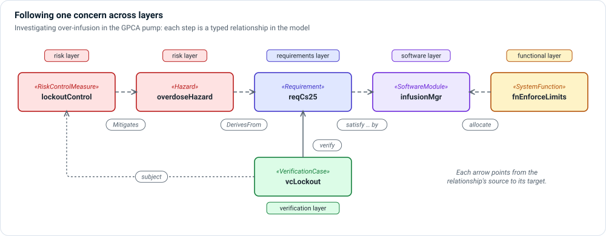

# First Workbench Session

Use the bundled GPCA pump to learn the workbench before opening your own model.

## 1. Launch the example

With Architect installed:

```bash
memo-architect --example gpca
```

From a development checkout of this repository, build first and use the
`example:dev` script:

```bash
pnpm install
pnpm run build
pnpm run example:dev
```

Open `http://localhost:3000` if the browser does not open by itself. The
example runs from a disposable copy, so you can edit freely.

## 2. Orient yourself

Open **☰ › Model › Architecture** or **Assurance** and use the explorer's
search to find `actorPatient`, `needSafeTherapy` and `fcPatientBolus`. Select
each one and look at the Properties panel:

- its MEMO kind (which tells you its [layer](../modeling/layers/index.md));
- its stable id and descriptive attributes;
- incoming and outgoing relationships;
- the views it appears in;
- validation findings about it.

## 3. Follow one trace

Follow the patient-bolus concern from the person to the proof:

1. **Patient** (`actorPatient`, a `User`) requests a bolus.
2. The **request-bolus** step is an operative action in a scenario of the
   *Deliver PCA therapy* use case.
3. The **patient-bolus functional flow** (`fcPatientBolus`) shows the system
   functions involved, including **enforce limits**.
4. **REQ-CS-25** says when a bolus request must be ignored. It derives from the
   request-bolus step, the over-infusion hazard and that hazard's risk estimate.
5. The **lockout control** mitigates the **opioid over-infusion** hazard.
6. **VER-002** (`vcLockout`) verifies the requirement and exercises the control,
   and produces evidence.



The views show more detail than this. Focus on why each element exists and
what claim each relationship makes.

## 4. Change the viewpoint

Open **☰ › Views › Viewpoints** and compare:

- the **context** view, for what lies outside the pump;
- a **functional flow** view, for behavior;
- the **requirements traceability** view, for derivation and coverage;
- the **risk chain** view, for hazards and controls;
- the **verification coverage** view, for evidence readiness;
- the **device interconnect** IBD, for what is connected to what—see
  [how to read an IBD](../modeling/views/interconnection.md).

The same element appears in several views. Changing it once changes it
everywhere.

## 5. Inspect gaps

Expand the **Problems** bar at the bottom. Select a finding to go to the
affected element. Decide whether the issue is missing information, the wrong
kind, the wrong relationship, or an intentional scope boundary.

Next, read [Layers and Their Questions](layers.md) and the
[Modeling](../modeling/index.md) section before creating new content.
