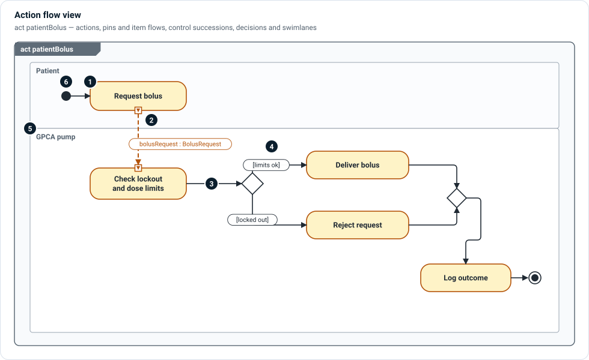

# Worked GPCA Example

The bundled Generic Patient-Controlled Analgesia (GPCA) pump is the complete
MEMO reference model. It is a research example, not a reusable device design:
use its organization, traceability patterns and review views, but never copy
its requirements, risk estimates, acceptance criteria or evidence as a claim
about another product.

Open it with:

```bash
memo-architect --example gpca
```

## What the example shows

GPCA is deliberately broader than a diagram demo. Its catalog covers the
clinical context, operational scenarios, requirements, functional behavior,
logical, physical and software architecture, safety risk, cybersecurity,
verification and validation, and document views. `gpca_trace.sysml` connects
those records with typed relationships; each view selects a review-sized
projection of that same source.

Use one scenario to orient yourself: **a patient requests a bolus during a
lockout interval**. The model should show that

1. the request is recognized (`oaRequestBolus`, an operative action);
2. the dose and lockout limits are checked (`fnEnforceLimits`, a system
   function in the `fcPatientBolus` flow);
3. no unsafe command is issued, and the outcome is logged;
4. the requirement that says so (`reqCs25`) derives from the request, the
   over-infusion hazard and its risk estimate;
5. the risk control (`lockoutControl`) mitigates the hazard; and
6. a verification case (`vcLockout`) verifies the requirement, exercises the
   control, and produces evidence.



The figure is an illustration of this scenario as an action flow; the model's
own *Infusion Delivery Action Flow* view (`VIEW-BHV-003`) shows the full
version. In the model, follow each relationship's own ends for the
authoritative direction.

## Read the model in a useful order

| Read this | To answer | Files (under `model/catalog/`) |
| --- | --- | --- |
| Context and operational catalog | Who uses the pump, where, and what can go wrong in use? | `gpca_context.sysml`, `gpca_operational.sysml` |
| System and behavior catalog | What should happen for a bolus, an alarm, or startup? | `gpca_system.sysml`, `gpca_behavior_actions.sysml`, `gpca_behavior_modes.sysml` |
| Requirements catalog | Which measurable claims constrain that behavior? | `gpca_requirements.sysml` |
| Architecture and interfaces | Which hardware and software own the behavior and exchange information? | `gpca_architecture.sysml`, `gpca_interfaces.sysml`, `gpca_physical.sysml` |
| Risk and cybersecurity catalog | What harm or compromise is controlled, and by what? | `gpca_risk.sysml`, `gpca_cybersecurity.sysml` |
| Verification and trace catalog | What proves each claim, and what is still unconnected? | `gpca_verification.sysml`, `gpca_trace.sysml` |

Do not start by reading every file. Choose one question, find the named element
in the explorer, and follow its typed relationships in both directions. Repeat
with the alarm-response and startup scenarios to see which parts are reused and
which are scenario-specific.

## Use the views as review tools

| Review question | GPCA view | What a good review checks | How to read it |
| --- | --- | --- | --- |
| What is outside the pump boundary? | System context (`VIEW-CTX-101`) | Actors, external systems and exchanges are explicit. | [Context view](../modeling/views/use-case-and-context.md#context-view) |
| What do users want to do? | Use cases (`VIEW-OPS-101`) | Every goal has a realizing workflow. | [Use case view](../modeling/views/use-case-and-context.md#use-case-view) |
| How is the device decomposed? | System decomposition (`VIEW-LOG-002`) | Containment is clear without claiming signal direction. | [General view](../modeling/views/general.md) |
| What flows between parts? | Device interconnect (`VIEW-LOG-003`) | Ports and flows point from provider to consumer. | [Interconnection view](../modeling/views/interconnection.md) |
| Which part owns each function? | Function allocation (`VIEW-FUN-102`) | Every function has a responsible element. | [Grid view](../modeling/views/grid.md) |
| What happens next? | Mode states (`VIEW-BHV-001`), action flow (`VIEW-BHV-003`), scenario sequence (`VIEW-BHV-002`) | Nominal and safety paths are distinguishable. | [State](../modeling/views/state-transition.md), [action flow](../modeling/views/action-flow.md), [sequence](../modeling/views/sequence.md) |
| How does a fault reach harm? | Risk chain (`VIEW-RISK-101`), FMEA (`VIEW-RISK-102`) | Each control appears in the chain, not only as a label. | [Risk layer](../modeling/layers/risk.md) |
| What still lacks proof? | Verification coverage (`VIEW-VER-101`) | Requirements and controls have meaningful cases and evidence. | [Verification layer](../modeling/layers/verification.md) |

## Source and scope

Architect runs the example from its installed `@memoarchitect/ontology`
dependency, in `node_modules/@memoarchitect/ontology/examples/gpca-pump`
(opened as a disposable copy, so edits last only for the session). The
`catalog` directory owns the
elements, `gpca_trace.sysml` owns cross-layer connections, and
`catalog/viewpoints` holds the purpose-built views, including document views so
review artifacts come from the same source rather than a second record system.

For neutral renderer fixtures that use no MEMO types, see the
`standard-sysml-diagrams` example (`memo-architect --example
standard-sysml-diagrams`). It contains standard SysML v2 BDD, IBD, requirements
and action-flow inputs, and is intentionally not part of GPCA.
