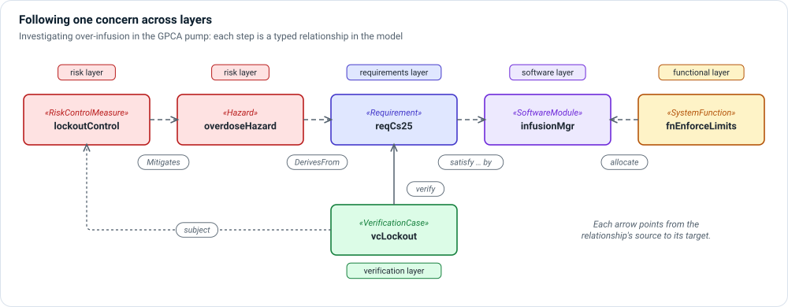

# Layers and Their Questions

Layers make a large model understandable by separating engineering questions.
They are not sequential project phases: you will usually add a little to several
layers at once and grow them together.

| Layer | Question | Typical kinds |
|---|---|---|
| [Context](../modeling/layers/context.md) | Who uses the device, where, and with what external systems? | `IntendedUse`, `User`, `UseContext` |
| [Operational](../modeling/layers/operational.md) | What work and outcomes matter to stakeholders? | `UseCase`, `OperationalWorkflow`, `OperativeScenario` |
| [Requirements](../modeling/layers/requirements.md) | What measurable claims must be true? | `Need`, `Requirement` |
| [Functional](../modeling/layers/functional.md) | What does the system do, and in what order? | `SystemFunction`, `FunctionalFlow` |
| [Logical](../modeling/layers/logical.md) | Which implementation-neutral parts own the responsibilities? | `System`, `Subsystem`, `LogicalComponent` |
| [Software](../modeling/layers/software.md), [Hardware and physical](../modeling/layers/hardware-physical.md) | What realizes the logical design? | `SoftwareModule`, `ProcessingNode`, `HardwareAssembly`, `PhysicalPort` |
| [Deployment](../modeling/layers/deployment.md) | What runs where? | `SoftwareDeploymentUnit`, `DeploysTo` |
| [Risk](../modeling/layers/risk.md), [Cybersecurity](../modeling/layers/cybersecurity.md), [Human factors](../modeling/layers/human-factors.md) | What could cause harm or compromise, and how is it controlled? | `Hazard`, `RiskControlMeasure`, `Threat`, `UseError` |
| [Verification and validation](../modeling/layers/verification.md) | What evidence supports each claim? | `VerificationCase`, `ValidationCase`, `MemoEvidence` |

Each layer has its own page in the [Modeling](../modeling/index.md) section,
with a figure of what you can model, the kinds and relationships available, and
an example.

## How to use layers in Architect

1. Begin with a review question.
2. Choose the viewpoint that covers the relevant layers.
3. Select an element and follow its typed relationships across layers.
4. Switch to a neighboring viewpoint only when the question changes.

For example, a reviewer investigating over-infusion moves between the hazard,
its control, the requirement derived from the hazard, the software and function
that answer it, and the test that verifies it:

## Organizing files

Folders may mirror layers, but the **kind**—not the folder—decides where an
element belongs. Use files and packages for ownership and review; use MEMO
kinds and relationships to preserve meaning.
