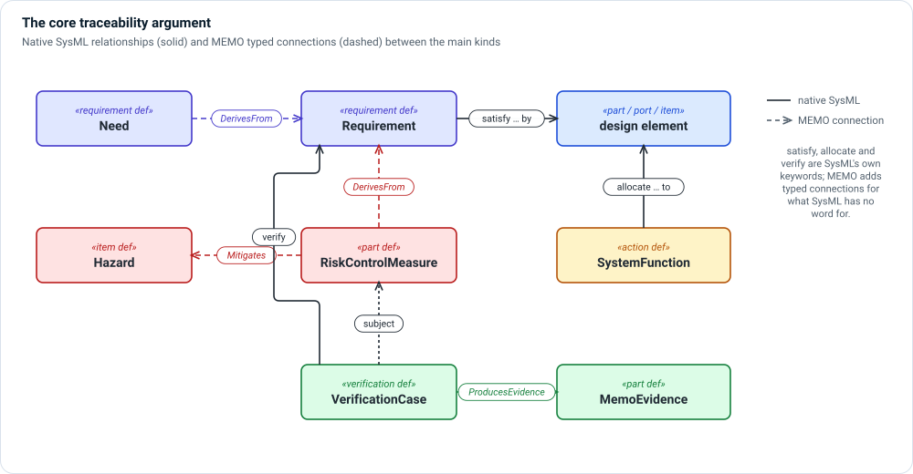

# Model Your Device

Model one engineering argument at a time. This guide builds a single slice—from
a stakeholder need to verification evidence—for an infusion pump, in SysML v2
with MEMO kinds.



The [Modeling](../modeling/index.md) section describes every kind used here,
layer by layer.

## Define the elements

```sysml
package infusion_pump {
    private import memo::*;

    // Requirements layer
    requirement needSafeDelivery : Need {
        attribute :>> needKind = NeedKind::'stakeholder';
        @MemoIdentity { :>> providedId = "NEED-001"; :>> label = "SafeDelivery"; }
        attribute :>> statement =
            "The patient needs medication delivered without unintended over-infusion.";
    }
    requirement reqDetectOverDelivery : Requirement {
        attribute :>> requirementType = RequirementTypeKind::system;
        @MemoIdentity { :>> providedId = "REQ-001"; :>> label = "DetectOverDelivery"; }
        attribute :>> statement =
            "The pump shall detect flow above the configured limit within 2 s.";
    }

    // Functional and logical layers
    action fnMonitorFlow : SystemFunction {
        @MemoIdentity { :>> providedId = "FUNC-001"; :>> label = "MonitorFlow"; }
    }
    part safetyMonitor : LogicalComponent {
        @MemoIdentity { :>> providedId = "LC-001"; :>> label = "SafetyMonitor"; }
        attribute :>> responsibility = "Independently detects over-delivery and stops the pump.";
    }

    // Risk layer
    item hzOverInfusion : Hazard {
        @MemoIdentity { :>> providedId = "HZ-001"; :>> label = "OverInfusion"; }
        attribute :>> severity = SeverityKind::catastrophic;
    }
    part rcIndependentMonitor : RiskControlMeasure {
        @MemoIdentity { :>> providedId = "RC-001"; :>> label = "IndependentFlowMonitor"; }
    }

    // Verification layer
    verification vcShutoff : VerificationCase {
        @MemoIdentity { :>> providedId = "VER-001"; :>> label = "OverDeliveryShutoffTest"; }
        attribute :>> methodKind = MemoVerificationMethodKind::test;
        attribute :>> acceptanceCriteria = "Pump stops within 2 s of flow exceeding the limit.";
        objective { verify reqDetectOverDelivery; }
        subject verified : Base::Anything[*] = (rcIndependentMonitor, safetyMonitor, fnMonitorFlow);
    }
    part evShutoffReport : MemoEvidence {
        @MemoIdentity { :>> providedId = "EV-001"; :>> label = "ShutoffTestReport"; }
    }
}
```

## Connect the argument

```sysml
// The requirement exists because of the need, and because of the control.
connection : DerivesFrom
    connect sourceDriver ::> needSafeDelivery
    to targetRequirement ::> reqDetectOverDelivery;
connection : DerivesFrom
    connect sourceDriver ::> rcIndependentMonitor
    to targetRequirement ::> reqDetectOverDelivery;

// The function satisfies the requirement; the component owns the function.
satisfy reqDetectOverDelivery by fnMonitorFlow;
allocate fnMonitorFlow to safetyMonitor;

// The control mitigates the hazard.
connection : Mitigates
    connect control ::> rcIndependentMonitor
    to mitigatedElement ::> hzOverInfusion {
    attribute :>> mitigationKind = MitigationKind::hazard;
}

// The test produced the evidence. (What it verifies is in its objective.)
connection : ProducesEvidence
    connect producer ::> vcShutoff
    to producedEvidence ::> evShutoffReport;
```

## Review the slice

Save the file and open it in Architect: the model reloads, and the Problems bar
shows what the closure rules still expect. Then ask:

- Is the need written in stakeholder language?
- Is the requirement measurable?
- Is the function independent of implementation?
- Is component responsibility explicit?
- Does the control genuinely reduce the hazard, and is the hazard's chain to
  harm modeled?
- Does the verification case check the requirement, with the control among the
  subjects it exercises?

Use [Choosing Elements](elements.md) and
[Connecting Elements](relationships.md) when extending the slice.
