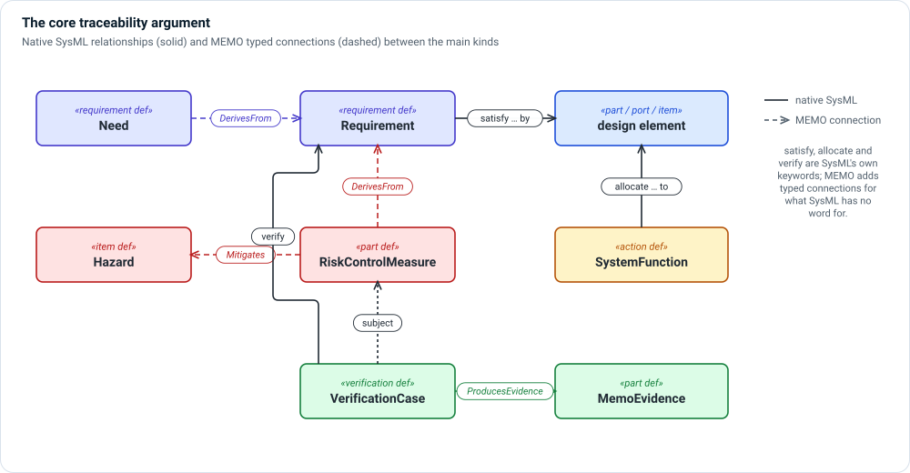

# Connecting Elements

Relationships turn a catalog into an engineering argument. In Architect, follow
them to understand why an element exists, what it affects, and how it is
supported.



MEMO uses SysML's own relationships wherever SysML has one, and adds typed
connections for what SysML has no word for.

## Native SysML relationships

| Write | Read it as |
|---|---|
| `satisfy reqX by elementY;` | This design element satisfies this requirement. |
| `allocate fnX to componentY;` | This component is responsible for this function. |
| `objective { verify reqX; }` in a verification case | This case verifies this requirement. |
| `subject verified = (controlY, …);` in a verification case | This case exercises these elements, for example a risk control. |
| `#refinement dependency x to y;` | This element refines that one. |
| `interface … connect a to b;` | These two ports are connected by this interface. |
| `flow of Item from a to b;` | This item flows from one port or pin to another. |

## MEMO typed connections

| Relationship | Read it as | Layer page |
|---|---|---|
| `DerivesFrom` | This requirement is driven by this need, control or parent requirement. | [Requirements](../modeling/layers/requirements.md) |
| `Mitigates` | This control mitigates this hazard, cause or vulnerability. | [Risk](../modeling/layers/risk.md) |
| `TracesRisk`, `Causes` | One risk element leads to the next. | [Risk](../modeling/layers/risk.md) |
| `ReducedBy` | This residual risk is reduced by this control. | [Risk](../modeling/layers/risk.md) |
| `ProducesEvidence` | This verification case produced this evidence. | [Verification](../modeling/layers/verification.md) |
| `Validates` | This validation case validates this need. | [Verification](../modeling/layers/verification.md) |
| `RealizesUseCase` | This workflow realizes this use case. | [Operational](../modeling/layers/operational.md) |
| `BuildsInto`, `DeploysTo`, `RealizedBy` | What builds into what, runs where, realizes what. | [Deployment](../modeling/layers/deployment.md) |
| `ThreatenedBy`, `Exploits`, `ImpactsSafety` | The threat model and its safety impact. | [Cybersecurity](../modeling/layers/cybersecurity.md) |
| `CommitsUseError`, `ErrorAtElement` | Use errors, the tasks and UI elements involved. | [Human factors](../modeling/layers/human-factors.md) |

A MEMO connection names its ends, so the direction is explicit:

```sysml
connection : DerivesFrom
    connect sourceDriver ::> needSafeTherapy
    to targetRequirement ::> reqCs25;

connection : Mitigates
    connect control ::> lockoutControl
    to mitigatedElement ::> overdoseHazard {
    attribute :>> mitigationKind = MitigationKind::hazard;
}

connection : ProducesEvidence
    connect producer ::> vcLockout
    to producedEvidence ::> evidenceLockout;
```

`memo-architect ontology show` lists every relationship the project's ontology
provides, with its ends.

## Inspecting a relationship

When you select an edge or a trace cell, check that:

1. the relationship type is more precise than a generic trace;
2. the source and target ends are the right way round;
3. both ends are the intended elements;
4. the claim has an engineering rationale;
5. a reviewer could challenge and resolve the claim.

## Do not optimize for edge count

More relationships do not automatically mean better traceability. Add the links
needed for a clear argument and for justified closure rules. Avoid speculative
or duplicated links that hide uncertainty.
