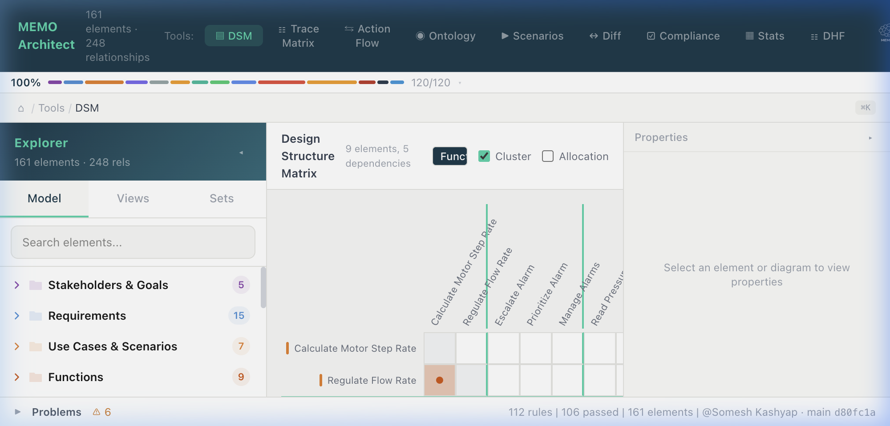
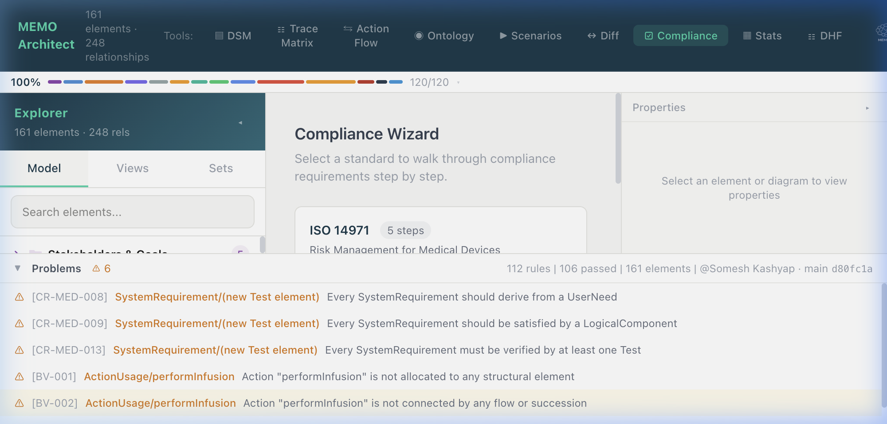
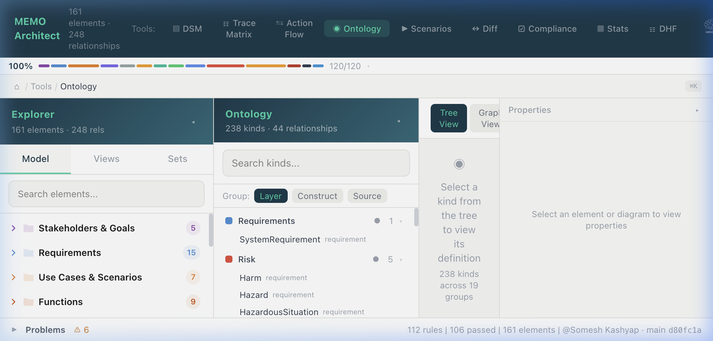

# Use the Workbench

Start with a question, not a canvas. Architect is most useful when you can say
what you need to review—"which control mitigates this hazard?" or "does this
requirement have verification evidence?"—and then choose the smallest view that
answers it.

## Orient yourself

| Area | Where | Use it for |
|---|---|---|
| **Navigation** | **☰**, top left | Move between pages: Home, Views, Model, Advanced, Settings |
| **Explorer** | Left side of Model, Viewpoints, Use Cases and Documents pages | Find elements by kind, package or name; pick a view |
| **Main view** | Centre | Read the selected diagram, table, matrix or document |
| **Properties** | Right side, when something is selected | Attributes, relationships, the views an element appears in |
| **Problems bar** | Bottom | Validation and consistency findings |
| **Top bar** | Top | Role, compiler, search (command palette), workspace |

See the [Feature Tour](features.md) for every page in the navigation.

## A five-minute review

Use the bundled GPCA model (`memo-architect --example gpca`) and follow one
patient-bolus concern.

1. Open **☰ › Model › Assurance**, filter to `Need`, and select
   `needSafeTherapy`.
2. Read its relationships in the Properties panel: what derives from it, and
   what it is validated by.
3. Open **☰ › Views › Viewpoints** and choose a requirements or functional
   view to see the design response.
4. Switch to the risk viewpoint to find the related hazard and its controls.
5. Open **☰ › Model › Traceability Matrix**, choose the quick trace
   *Requirement → Test case*, and filter to **Missing** to see what has no
   verification yet.

If a view becomes crowded, go back to the selected element and ask a narrower
question. A crowded diagram is a sign to change the lens, not to add another
copy of the model.

## The Model Explorer

- Elements are grouped by **kind** first. Requirements are grouped by
  requirement type, use cases by declared level.
- **Show packages as folders** (the switch beside the collapse button, or
  Settings) adds the package level under each kind.
- **Filter element types** and **Filter systems** narrow the tree. Both are
  searchable lists with counts.
- Explorer rows show display names; the id appears beside them.

How the explorer's kind folders relate to modeling layers is explained in
[Layers](../modeling/layers/index.md).

## Find dependencies and gaps

**☰ › Advanced › Design Structure Matrix** highlights dependency patterns. Use
it to prepare a technical discussion, then go to the connected elements to
understand the engineering reason for each dependency.

The **Problems** bar reports validation and consistency findings. Treat each
finding as a review prompt: inspect the affected source and decide whether to
add missing information, correct a relationship, or record an explicit scope
boundary.

## Explore the vocabulary

**☰ › Settings › Ontology Explorer** (experimental) shows the element kinds and
relationships the project's ontology provides. It is a reference, not a second
place to author project meaning. For a guided description of the same
vocabulary, read the [Modeling](../modeling/index.md) section.

## Settings

**☰ › Settings** groups settings by what they act on:

- **Model** — show packages as folders; open **Rules** (which rules apply, by
  layer) and **Methodology** (the layers and extensions the model uses).
- **Features** — switch experimental features on for yourself.
- **Documents** and **AI assistant** — document export and LLM provider
  settings.

The **Compiler** control in the top bar sets the project's compiler, and
separately your own default ("just for me").

## Optional assistance

Where a provider is configured and AI Tools is switched on, **☰ › Model ›
AI Tools** can answer questions about the model and draft SysML. The assistant
cannot write to the model on its own: suggested edits are staged as proposals
and written only when you approve them. Review generated text as carefully as
any other engineering input; assistance does not approve a requirement, a risk
control or an evidence claim.

See [Intelligence and AI](ai-features.md), and
[AI Coding Tools (MCP)](mcp-cursor.md) to use the model from Cursor or Claude
Code.
